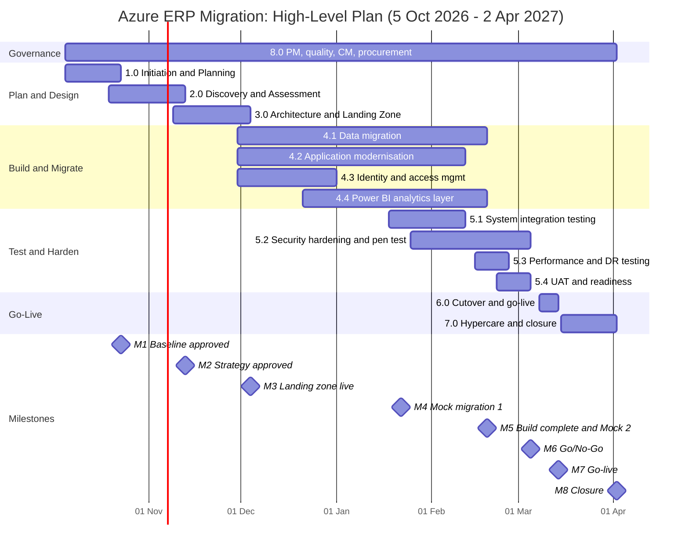

<div align="center">

# SOFTWARE PROJECT MANAGEMENT PLAN (SPMP)

## Cloud Migration of a Mid-Sized Retail Company's Legacy On-Premise ERP System to Microsoft Azure
### (Including Power BI Analytics Layer and Security Hardening)

**Prepared in accordance with IEEE Std 1058 (Software Project Management Plans)**

---

**Assessment:** Professional Development Assessment T3
**Institution:** Cape Peninsula University of Technology (CPUT)
**Qualification:** Advanced Diploma in ICT Applications Development
**Prepared by:** Thabiso (Student No. 220296006)
**Module code:** [insert module code]  |  **Lecturer:** [insert lecturer name]
**Project Manager (role played):** Senior Project Manager, Cloud Migration Programme
**Document version:** 1.0 (Baseline draft for Steering Committee approval)
**Date:** 20 September 2026

</div>

> **Scenario note.** The client, *Karoo Retail Group (Pty) Ltd*, is a fictitious mid-sized South African retailer created for this assessment. All figures are planning estimates in South African Rand (ZAR, excluding VAT at 15%) and are justified in the relevant sections. Items in square brackets are placeholders.

---

## Document Control

| Item | Detail |
|---|---|
| Document title | SPMP: ERP Cloud Migration to Microsoft Azure |
| Standard | IEEE Std 1058 (SPMP); supported by IEEE 828 (CM), IEEE 730 (SQA), IEEE 1028 (Reviews and Audits) |
| Status | Draft for approval at Gate G1 (23 Oct 2026) |
| Owner | Project Manager |
| Review cycle | Reviewed at every stage gate; re-baselined only via approved change request |
| Distribution | Steering Committee, project team, MSP, Information Officer |

| Version | Date | Author | Change |
|---|---|---|---|
| 0.1 | 07 Sep 2026 | Project Manager | Initial outline |
| 0.9 | 15 Sep 2026 | Project Manager | Internal review complete |
| 1.0 | 20 Sep 2026 | Project Manager | Baseline draft |

---

## Table of Contents

**Front matter:** Title Page; Document Control; Table of Contents; List of Abbreviations

1. Project Charter / Project Mandate
2. Business Justification and Project Selection
3. Lifecycle and Delivery Approach (Hybrid Waterfall + Agile)
4. Work Breakdown Structure (WBS)
5. Schedule, Milestones and Resource Planning
6. Cost and Budget Management
7. Strategic and Tactical Management
8. Human Resource Management
9. Configuration and Change Management
10. Decision (Rationale) Management
11. Risk Management
12. Quality Management
13. Procurement Management
14. Project Monitoring and Reporting
15. Appendices
 - Appendix A: High-Level Gantt Chart
 - Appendix B: Monthly Cash Flow Projection (ZAR)
 - Appendix C: Detailed Risk Register
 - Appendix D: RACI Matrix
 - Appendix E: Resource Histogram / Effort Summary
 - Appendix F: IEEE 1058 Cross-Reference
 - Appendix G: Glossary
 - Appendix H: References

### List of Abbreviations

| Abbrev. | Meaning | Abbrev. | Meaning |
|---|---|---|---|
| AD | Application Modernisation Developer | MSP | Managed Service Provider |
| BA | Business Analyst and Change Lead | MTTF / MTTR | Mean Time To Failure / To Repair |
| BAC | Budget at Completion | PBI | Power BI |
| CAF / WAF | Cloud Adoption / Well-Architected Framework | PM | Project Manager |
| CCB | Change Control Board | POPIA | Protection of Personal Information Act 4 of 2013 |
| CE | Cloud Migration Engineer | QA | Quality Assurance / QA Test Lead |
| CM | Configuration Management | RACI | Responsible, Accountable, Consulted, Informed |
| CPI / SPI | Cost / Schedule Performance Index | RPO / RTO | Recovery Point / Time Objective |
| CSP | Cloud Solution Provider (Microsoft programme) | SA | Solution Architect |
| DE | Data Migration Engineer | SE | Security and IAM Engineer |
| EVM | Earned Value Management | SteerCo | Steering Committee |
| IaC | Infrastructure as Code | UAT / SIT | User Acceptance / System Integration Testing |
| KPA | Key Process Area (CMM) | WBS | Work Breakdown Structure |

---

# 1. Project Charter / Project Mandate

*(IEEE 1058 §1 Overview; §4 Project Organisation)*

## 1.1 Purpose of this Document

This SPMP is the single authoritative plan for the six-month migration of Karoo Retail Group's legacy on-premise Enterprise Resource Planning (ERP) system to Microsoft Azure. It serves as the project charter and mandate, and it defines how the project is organised, scheduled, costed, controlled and assured. Its approval at Gate G1 authorises the Project Manager to commit resources against the baselines set out here.

## 1.2 Background and Mandate

Karoo Retail Group operates 38 stores nationally with an e-commerce channel that contributes roughly 18% of sales. Group turnover is approximately R3.1 billion and the company employs about 1,600 people. Head office and the on-premise data centre are in Johannesburg (Midrand), while e-commerce fulfilment and customer care operate from Cape Town.

The current ERP is 11 years old and covers finance (GL, AP, AR), inventory, procurement, sales order management and warehouse management. It runs on Windows Server 2012 R2 and SQL Server 2014, both outside Microsoft extended support. The database is about 1.8 TB, the system has roughly 380 named users, and it exchanges data with 14 systems (POS, e-commerce platform, supplier EDI, payroll, banking, courier and others). The hardware is out of warranty and due for a capital refresh. Disaster recovery relies on backups with a recovery time of about 48 hours. Management reporting is largely manual and spreadsheet-based.

**Mandate.** The Executive Committee has mandated the IT Division to migrate the ERP to Microsoft Azure within six months. The migration must modernise the platform, provide a governed Power BI analytics layer, and harden security to POPIA standard, all without disrupting trading.

## 1.3 Project Objectives (SMART)

| # | Objective | Measure / Target | Due |
|---|---|---|---|
| O1 | Migrate all in-scope ERP modules and 14 integrations to Azure | 100% modules and interfaces live in Azure production | 14 Mar 2027 |
| O2 | Preserve data integrity | ≥ 99.99% record-count match; 100% financial balances (GL, sub-ledgers, stock valuation) reconcile | Mock 2 (19 Feb 2027) and go-live |
| O3 | Improve resilience | Availability ≥ 99.9% monthly during hypercare; RTO ≤ 4 h and RPO ≤ 15 min proven in a DR test | 26 Feb 2027 (test); 2 Apr 2027 (hypercare exit) |
| O4 | Deliver Power BI analytics layer | ≥ 12 governed reports across 4 dashboards (sales, inventory, finance, e-commerce); ≥ 60 users trained | 5 Mar 2027 |
| O5 | POPIA-aligned security | 0 open critical/high pen-test findings at go-live; Defender secure score ≥ 80%; MFA on 100% of accounts | 5 Mar 2027 |
| O6 | Deliver within time and cost | Complete within 26 weeks; cost within ±5% of the R7,770,400 baseline | 2 Apr 2027 |
| O7 | Sustain benefits | Handover to operations with run-cost model and FinOps reporting | 2 Apr 2027 |

## 1.4 Scope Statement

**In scope**
1. Discovery and assessment of the ERP estate, dependencies, licences and data.
2. Azure landing zone: management groups, subscriptions, policy, hub-and-spoke network, VPN/ExpressRoute connectivity, monitoring, Key Vault and IaC pipelines.
3. Full ERP migration: application tier replatformed to Azure VMs, database to Azure SQL Managed Instance (subject to decision D-03), and re-engineering of 14 integrations onto an Azure integration layer.
4. Data migration: mapping, cleansing, two full mock migrations, final cutover load and reconciliation.
5. Application modernisation: targeted refactoring, CI/CD pipelines, and decoupling of reporting from the transactional database.
6. Identity and Access Management: Microsoft Entra ID hybrid identity, MFA, Conditional Access, RBAC, Privileged Identity Management and ERP single sign-on.
7. Security hardening: CIS/Microsoft cloud security benchmark baselines, Defender for Cloud, an independent penetration test, and a POPIA compliance review and DPIA.
8. Power BI analytics layer: semantic model, reports, row-level security, and deployment pipelines.
9. Testing (SIT, performance, DR, UAT), training, cutover, and three weeks of hypercare.

**Out of scope:** new ERP functionality or business-process re-engineering; replacement of POS hardware or store networks; Microsoft 365 migration; building a 24×7 SOC (a Sentinel-based SOC is deferred, see D-10); physical decommissioning of hardware; enterprise data warehouse beyond the reporting model; ERP vendor licence renegotiation.

## 1.5 Key Deliverables

| ID | Deliverable | Gate |
|---|---|---|
| D1 | Approved SPMP and baselines | G1 |
| D2 | Discovery and Migration Strategy Report (6R disposition, TCO, POPIA data classification) | G2 |
| D3 | Target architecture (HLD/LLD) and operational Azure landing zone | G3 |
| D4 | Migrated ERP environments (Dev, SIT, UAT, Prod, DR) built as IaC | G4–G6 |
| D5 | Data migration toolkit, mapping, reconciliation reports | G4–G5 |
| D6 | Identity platform, security baseline, pen-test and POPIA reports | G6 |
| D7 | Power BI solution (model, reports, RLS, deployment pipeline) | G5–G6 |
| D8 | Test evidence pack, training material, runbooks, cutover plan | G6 |
| D9 | Production go-live, hypercare report, handover pack and lessons learned | G7 |

## 1.6 Summary Schedule and Budget

- **Start:** Monday 5 October 2026. **Finish:** Friday 2 April 2027 (26 weeks, exactly six months).
- **Go-live:** cutover weekend 12 to 14 March 2027.
- **Total direct cost:** R7,064,000. **Contingency (10%):** R706,400. **Cost baseline (BAC):** R7,770,400. **Management reserve (5% of direct, held by the SteerCo):** R353,200. **Total funding envelope:** R8,123,600.

## 1.7 Assumptions, Constraints and Dependencies

| Type | Statement |
|---|---|
| Assumption | The ERP vendor confirms support for Azure VMs and Azure SQL Managed Instance by end of Discovery (else fallback in D-03). |
| Assumption | Existing Windows Server/SQL licences carry Software Assurance, enabling Azure Hybrid Benefit. |
| Assumption | Client SMEs are available for 6 h per week each during UAT. |
| Assumption | Azure services required are available in South Africa North (primary) and South Africa West (DR); verified in Discovery. |
| Constraint | Fixed six-month duration; nine-person team; ZAR budget of R8,123,600. |
| Constraint | Black Friday (27 Nov 2026) and the festive trading period: no production-impacting changes or heavy extracts from the legacy system during peak windows. |
| Constraint | POPIA: personal information must remain protected, operator agreements must be in place, and cross-border transfers avoided or lawfully justified. |
| Dependency | Telecom provider delivers ExpressRoute/VPN circuits by 27 Nov 2026 (lead-time risk R12). |
| Dependency | Microsoft Solutions Partner (MSP) contract awarded by 6 Nov 2026. |

## 1.8 Success Criteria and Acceptance

The project is successful when (a) all objectives O1 to O7 are met, (b) the Sponsor signs the acceptance certificate at Gate G7, (c) trading is uninterrupted beyond the approved cutover window, and (d) the post-implementation review confirms the run-cost and benefit model.

## 1.9 Project Manager Authority

The PM may approve changes up to R50,000 and 2 working days of schedule impact, direct the team day to day, escalate to the SteerCo, and stop work on quality or security grounds. Larger changes follow Section 9.

## 1.10 Approvals

| Role | Name | Signature | Date |
|---|---|---|---|
| Executive Sponsor (CIO) | [name] | | |
| Business Owner (COO) | [name] | | |
| Finance Director | [name] | | |
| Information Officer (POPIA) | [name] | | |
| Project Manager | [name] | | |

---

# 2. Business Justification and Project Selection

## 2.1 Problem Statement and Drivers

| Driver | Evidence | Consequence if unaddressed |
|---|---|---|
| End-of-support platform | Windows Server 2012 R2 and SQL Server 2014 are outside extended support | Unpatched vulnerabilities, audit findings, POPIA s19 exposure |
| Hardware refresh due | Servers out of warranty; capex of about R5.5 m required | Large capex with no strategic benefit |
| Poor resilience | 48 h RTO; single data centre; diesel/UPS dependency during outages | Trading loss during failures and grid instability |
| Peak scalability | Black Friday load requires over-provisioning all year | Idle capacity cost, e-commerce slowdowns |
| Weak analytics | Manual, spreadsheet-based reporting | Slow decisions, stock-outs and shrinkage |
| Regulatory pressure | POPIA enforceable; Information Regulator active | Fines up to R10 m and reputational harm |

## 2.2 Options Analysis (Project Selection)

Four options were evaluated with a weighted scoring model (1 = poor, 5 = excellent; for Risk, 5 = lowest risk).

| Criterion | Weight | A: Do nothing | B: On-prem refresh | **C: Azure replatform (selected)** | D: Replace with SaaS ERP |
|---|---|---|---|---|---|
| Strategic alignment | 25% | 1 | 2 | 5 | 5 |
| Financial return | 25% | 1 | 2 | 4 | 3 |
| Risk (5 = low) | 15% | 1 | 3 | 3 | 2 |
| Feasibility in 6 months | 15% | 5 | 4 | 4 | 1 |
| Compliance and security | 10% | 1 | 3 | 4 | 4 |
| Scalability and agility | 10% | 1 | 2 | 5 | 5 |
| **Weighted score (out of 5)** | 100% | **1.60** | **2.55** | **4.20** | **3.35** |

*Working example, Option C:* (5×25 + 4×25 + 3×15 + 4×15 + 4×10 + 5×10) / 100 = 420 / 100 = 4.20.

Option C is selected. Option D scores well strategically, but a SaaS ERP replacement cannot be delivered in six months and carries very high change and data-conversion risk. Option C is also a stepping stone to it.

## 2.3 Financial Analysis

**Investment:** R8,123,600 (full envelope including contingency and management reserve, the conservative case).

**Run-cost comparison (annual):**

| Cost line | Current on-prem | Post-migration Azure |
|---|---|---|
| Hardware maintenance and depreciation | R1,600,000 | R0 |
| Data centre, power, backup power | R1,200,000 | R0 |
| Infrastructure staff (allocated) / MSP managed services | R1,500,000 | R700,000 |
| Software licences (ERP, OS, DB) / cloud licences (Entra, Defender, Power BI) | R1,400,000 | R600,000 |
| DR and backup | R500,000 | Included in Azure |
| Azure consumption (reserved instances after stabilisation) | n/a | R2,600,000 |
| **Total** | **R6,200,000** | **R3,900,000** |
| **Annual run-cost saving** | | **R2,300,000** |

*Sources and assumptions:* Azure consumption modelled in the Azure Pricing Calculator (about R216,000 per month) and to be re-validated in Discovery; current costs from Finance. The BI benefit of R1.8 m p.a. comprises R0.6 m reporting labour saved and R1.2 m gross margin from reduced stock-outs and shrinkage. It is an assumption to be validated by the Business Owner.

**Five-year cash flows (R million; benefits at year-end, hurdle rate 11%, an assumed WACC to be confirmed by Finance):**

| Year | Base case: net flow | Discount factor | PV | Conservative: net flow | PV |
|---|---|---|---|---|---|
| 0 | (8.124) | 1.0000 | (8.124) | (8.124) | (8.124) |
| 1 | 9.600* | 0.9009 | 8.649 | 4.100 | 3.694 |
| 2 | 4.100 | 0.8116 | 3.328 | 4.100 | 3.328 |
| 3 | 4.100 | 0.7312 | 2.998 | 4.100 | 2.998 |
| 4 | 4.100 | 0.6587 | 2.701 | 4.100 | 2.701 |
| 5 | 4.100 | 0.5935 | 2.433 | 4.100 | 2.433 |
| **NPV** | | | **R11.99 m** | | **R7.03 m** |

*Year 1 base case = R2.3 m saving + R1.8 m BI benefit + R5.5 m avoided hardware refresh. The conservative case excludes the avoided capex.

| Metric | Base case | Conservative case |
|---|---|---|
| NPV (5 years @ 11%) | R11.99 m | R7.03 m |
| IRR (approx.) | ≈ 77% | ≈ 41% |
| Payback (after go-live) | ≈ 10 months | ≈ 24 months |
| Benefit-cost ratio (PV benefits / investment) | 2.48 | 1.87 |
| 5-year ROI | n/a | 152% ((20.5 − 8.124) / 8.124) |

Even without the avoided capex, the project returns a positive NPV, so the decision is robust.

## 2.4 Non-Financial Benefits

Non-financial benefits include a tested DR capability (RTO ≤ 4 h, RPO ≤ 15 min), elastic capacity for peak trading, a supported and patched platform, reduced dependency on grid-backed server rooms, a POPIA-aligned control set, and self-service analytics that shortens the reporting cycle.

## 2.5 Benefits Realisation

The Business Owner owns benefit tracking. A benefits register (run-cost, availability, report usage, stock-out rate) is baselined at go-live and reviewed at 3, 6 and 12 months after go-live.

---

# 3. Lifecycle and Delivery Approach

## 3.1 Recommendation: Hybrid (Waterfall + Agile)

A **hybrid approach** is recommended. It uses a stage-gated (Waterfall) macro-structure for the phases that are plan-driven, dependency-heavy and audit-sensitive, and it runs 2-week Scrum sprints (with Kanban for infrastructure and security work) inside the Build phase.

## 3.2 Comparison of Approaches

| Criterion | Pure Waterfall | Pure Agile | **Hybrid (selected)** |
|---|---|---|---|
| Fixed end date and budget | Strong | Weak; scope floats | Strong: fixed gates, flexible build backlog |
| Migration has hard sequencing (network → identity → data → cutover) | Strong | Weak | Strong: gated sequence |
| Regulatory evidence (POPIA, audit trail) | Strong | Moderate | Strong: gate documents plus sprint evidence |
| Evolving requirements (BI reports, integration edge-cases) | Weak | Strong | Strong: backlog-driven |
| Early feedback and defect discovery | Weak (late testing) | Strong | Strong: sprint reviews, mock migrations |
| Cutover is a single high-risk event | Strong (formal planning) | Weak | Strong: formally planned and rehearsed |
| Team skill and client governance fit | Familiar to Steering Committee | Requires cultural change | Familiar governance, agile teams |

**Justification.** Cloud migration combines *predictable* work (assessment, landing zone, cutover, closure), which benefits from gates and fixed baselines, with *discovery-driven* work (integration re-engineering, data quality remediation, Power BI report design), where short feedback loops reduce rework. A six-month fixed end date rules out a fully adaptive approach. The hybrid also matches the Microsoft Cloud Adoption Framework (Strategy → Plan → Ready → Adopt → Govern → Manage), which is phase-based but iterates within *Adopt*.

## 3.3 Lifecycle Structure

```
 WATERFALL STAGE GATES                      AGILE / KANBAN INSIDE BUILD
 -------------------------------------      ------------------------------------------
 [1 Initiate & Plan] --G1-->
 [2 Discover & Assess] --G2-->
 [3 Architect & Landing Zone] --G3-->      Sprint 1..6 (2 weeks): data, app, IAM, BI
 [4 Build & Migrate] ------G4--G5-->       Kanban: landing-zone ops, security backlog
 [5 Test, Harden, Readiness] --G6-->       Mock migration 1 and 2 as increments
 [6 Cutover & Go-Live] (formal runbook)
 [7 Hypercare & Closure] --G7-->
 [8 PM, Quality, CM, Procurement] (continuous)
```

## 3.4 Stage Gates

| Gate | Date | Key exit criteria | Decision by |
|---|---|---|---|
| G1 Baseline | 23 Oct 2026 | SPMP, baselines, team mobilised, RFQ issued | SteerCo |
| G2 Strategy | 13 Nov 2026 | Inventory and dependencies complete; 6R strategy, TCO and POPIA classification approved | SteerCo |
| G3 Architecture | 4 Dec 2026 | HLD/LLD and security design approved; landing zone operational and scanned; connectivity live | SteerCo, Information Officer |
| G4 Mock 1 | 22 Jan 2027 | Mock migration 1 complete; reconciliation ≥ 99.9%; core ERP running in Azure test | PM, SA |
| G5 Build complete | 19 Feb 2027 | Mock migration 2 (dress rehearsal) ≥ 99.99%; Power BI in UAT; SIT exit met | SteerCo |
| G6 Go/No-Go | 5 Mar 2027 | UAT signed; no open Sev1/Sev2; pen test criticals closed; DR test passed; cutover rehearsed | Sponsor, Business Owner |
| G7 Closure | 2 Apr 2027 | Hypercare exit criteria met; handover accepted; lessons learned | Sponsor |

## 3.5 Agile Mechanics within Build

| Element | Approach |
|---|---|
| Sprint length and calendar | 2 weeks. S1: W9–10 (30 Nov–11 Dec); S2: W11–12 (14–25 Dec, reduced capacity); S3: W13–14 (28 Dec–8 Jan, reduced capacity); S4: W15–16; S5: W17–18; S6: W19–20 (stabilisation and mock 2) |
| Product Owner | Business Owner nominates; BA acts as proxy and manages the backlog |
| Delivery lead / Scrum Master | Project Manager facilitates; SA owns technical direction |
| Ceremonies | Planning (2 h), daily stand-up (15 min, Teams), review with business (1 h), retrospective (45 min) |
| Definition of Ready | Acceptance criteria written, dependencies known, estimate ≤ 16 h, security requirements tagged |
| Definition of Done | Code/IaC peer-reviewed; unit and automated tests pass; scanned for vulnerabilities; deployed via pipeline; documented; POPIA data-handling checked; QA accepted |
| Infrastructure and security work | Kanban with WIP limit of 3 per engineer; changes pass through change control (Section 9) |

## 3.6 Tailoring for South African Context

Peak-trading freezes (Black Friday and festive period) and a public-holiday cluster (16 Dec, 25 Dec, 1 Jan, 22 Mar, 26 Mar, 29 Mar) are built into sprint capacity. Load-shedding contingency (residual risk from grid instability) is handled through team resilience measures (Section 8.7) and a rehearsed cutover runbook with power and connectivity checks.

---

# 4. Work Breakdown Structure (WBS)

## 4.1 WBS Principles

The WBS is deliverable-oriented, applies the 100% rule (the sum of children equals the parent), and is decomposed to Level 3 (work packages) throughout. Level 4 tasks are held in Azure DevOps. Phases 1 to 7 are sequential stages, and 8.0 is continuous.

## 4.2 Hierarchical WBS

**Level 1 = phase, Level 2 = deliverable group, Level 3 = work package.**

**1.0 Initiation and Planning**
- 1.1 Project Initiation
 - 1.1.1 Charter and mandate approved
 - 1.1.2 Stakeholder register and engagement plan
 - 1.1.3 Governance set-up (SteerCo, CCB, RACI)
- 1.2 Project Planning
 - 1.2.1 SPMP and management plans (risk, quality, comms, procurement)
 - 1.2.2 Schedule, cost and resource baselines
 - 1.2.3 Tooling and environments (Azure DevOps, Teams, repositories)
- 1.3 Team Mobilisation
 - 1.3.1 Onboarding and access provisioning
 - 1.3.2 MSP and vendor RFQ issued

**2.0 Discovery and Assessment**
- 2.1 Estate Inventory
 - 2.1.1 Azure Migrate discovery and inventory
 - 2.1.2 Dependency and 14-interface mapping
 - 2.1.3 Licence and support-status review
- 2.2 Data Assessment
 - 2.2.1 Data profiling and quality baseline
 - 2.2.2 POPIA data classification and DPIA scoping
 - 2.2.3 Volume, growth and cutover-window analysis
- 2.3 Requirements
 - 2.3.1 Business and BI requirements
 - 2.3.2 Non-functional requirements (availability, RTO/RPO, performance)
 - 2.3.3 Compliance requirements (POPIA, PCI DSS scope via payment tokenisation)
- 2.4 Migration Strategy
 - 2.4.1 6R disposition per workload
 - 2.4.2 TCO and Azure cost model
 - 2.4.3 Migration and cutover approach
 - 2.4.4 Assessment report and G2 pack

**3.0 Architecture and Landing Zone**
- 3.1 Target Architecture
 - 3.1.1 Solution architecture (HLD/LLD)
 - 3.1.2 Network and connectivity design
 - 3.1.3 Backup and DR design
 - 3.1.4 Security and identity architecture
- 3.2 Landing Zone Build
 - 3.2.1 Management groups, subscriptions, policies, tagging
 - 3.2.2 Hub-and-spoke network, firewall, DNS
 - 3.2.3 VPN and ExpressRoute connectivity
 - 3.2.4 Monitoring, logging and Key Vault
 - 3.2.5 IaC pipelines and Dev/Test/UAT/Prod/DR environments
- 3.3 Landing Zone Validation
 - 3.3.1 Well-Architected review
 - 3.3.2 Security baseline scan
 - 3.3.3 G3 approval

**4.0 Build and Migration**
- 4.1 Data Migration
 - 4.1.1 Source-to-target mapping
 - 4.1.2 Replication and ETL pipelines
 - 4.1.3 Mock migration 1
 - 4.1.4 Mock migration 2 (dress rehearsal)
 - 4.1.5 Reconciliation reports
- 4.2 Application Modernisation
 - 4.2.1 ERP application-tier replatform to Azure VMs
 - 4.2.2 Database replatform to Azure SQL Managed Instance
 - 4.2.3 Integration layer (API Management, Service Bus, Logic Apps) for 14 interfaces
 - 4.2.4 CI/CD pipelines
 - 4.2.5 Reporting decoupled from OLTP (read replica or reporting store)
- 4.3 Identity and Access Management
 - 4.3.1 Entra ID tenant and hybrid synchronisation
 - 4.3.2 MFA and Conditional Access
 - 4.3.3 RBAC, PIM and joiner-mover-leaver process
 - 4.3.4 ERP single sign-on
- 4.4 Power BI Analytics Layer
 - 4.4.1 Semantic model (star schema)
 - 4.4.2 Reports and dashboards (sales, inventory, finance, e-commerce)
 - 4.4.3 Row-level security and governance (workspaces, sensitivity labels)
 - 4.4.4 Deployment pipeline and refresh scheduling

**5.0 Testing, Security Hardening and Readiness**
- 5.1 Test Planning and SIT
 - 5.1.1 Test strategy and cases
 - 5.1.2 SIT execution
 - 5.1.3 Defect triage and regression
- 5.2 Security Hardening
 - 5.2.1 CIS/MCSB baseline hardening
 - 5.2.2 Defender for Cloud and secure-score remediation
 - 5.2.3 Independent penetration test and remediation
 - 5.2.4 POPIA compliance review and DPIA
- 5.3 Non-Functional Testing
 - 5.3.1 Performance and load testing (peak-trading volumes)
 - 5.3.2 DR failover test (South Africa North to West)
 - 5.3.3 Backup and restore test
- 5.4 UAT and Readiness
 - 5.4.1 UAT execution
 - 5.4.2 End-user training and communications
 - 5.4.3 Operational readiness and runbooks
 - 5.4.4 Go/No-Go (G6)

**6.0 Cutover and Go-Live**
- 6.1 Cutover Planning
 - 6.1.1 Cutover runbook (timed)
 - 6.1.2 Rollback plan and decision points
 - 6.1.3 Trading freeze and communications
- 6.2 Cutover Execution
 - 6.2.1 Final data synchronisation
 - 6.2.2 Integration and DNS switch
 - 6.2.3 Smoke tests and business sign-off
- 6.3 Legacy Retirement Preparation
 - 6.3.1 Legacy set to read-only (90-day retention)
 - 6.3.2 Archive and decommission plan (handed to operations)

**7.0 Hypercare and Closure**
- 7.1 Hypercare
 - 7.1.1 Daily triage (command centre)
 - 7.1.2 Performance tuning and cost optimisation
 - 7.1.3 Parallel-run reconciliation
- 7.2 Transition to Operations
 - 7.2.1 Knowledge transfer
 - 7.2.2 Support model and SLAs
 - 7.2.3 Operations acceptance
- 7.3 Project Closure
 - 7.3.1 Sponsor acceptance (G7)
 - 7.3.2 Lessons learned
 - 7.3.3 Benefits realisation plan
 - 7.3.4 Final report and archive

**8.0 Project Management, Quality and Governance (continuous)**
- 8.1 Project Management
 - 8.1.1 Status reporting and SteerCo
 - 8.1.2 Risk and issue management
 - 8.1.3 Change control
- 8.2 Quality Management
 - 8.2.1 Quality plan, reviews and audits
 - 8.2.2 Metrics collection and reporting
 - 8.2.3 Process-improvement actions
- 8.3 Configuration Management
 - 8.3.1 Repositories and branching
 - 8.3.2 Baselines and release management
 - 8.3.3 Configuration audits (FCA/PCA)
- 8.4 Procurement and Vendor Management
 - 8.4.1 RFQ, evaluation and award
 - 8.4.2 Contract and licence administration
 - 8.4.3 Vendor performance reviews

## 4.3 WBS Dictionary (Level 2 excerpt)

| WBS | Deliverable | Acceptance criterion | Owner |
|---|---|---|---|
| 2.1 | Estate inventory and dependency map | 100% of servers, DBs and 14 interfaces documented; peer-reviewed | SA |
| 3.2 | Operational landing zone | Deployed from IaC; policy compliance ≥ 95%; connectivity tested | CE |
| 4.1 | Data migration toolkit | Mock 2 reconciliation ≥ 99.99%; financial balances 100% | DE |
| 4.2 | Replatformed ERP and integration layer | SIT exit criteria met; 14/14 interfaces pass | AD |
| 4.3 | Identity platform | 100% MFA; PIM live; JML process tested | SE |
| 4.4 | Power BI solution | ≥ 12 reports UAT-approved; RLS tested; refresh SLA met | BI |
| 5.2 | Hardened security posture | Zero open critical/high findings; secure score ≥ 80% | SE |
| 6.2 | Production cutover | Smoke tests 100% pass; business sign-off within window | PM |

## 4.4 Estimation Approach

Effort is estimated bottom-up per Level 3 package using three-point (PERT) estimates, E = (O + 4M + P) / 6. Example (WBS 4.1 data-migration pipelines): O = 520 h, M = 700 h, P = 1,000 h gives E = (520 + 2,800 + 1,000) / 6 = **720 h**. Estimates are cross-checked with parametric measures (Azure Pricing Calculator, data volume per hour of migration throughput) and with the estimating experience of the MSP. The estimating accuracy is a Class 3 estimate (−10% / +15%) at baseline, tightened at G2.

---

# 5. Schedule, Milestones and Resource Planning

*(IEEE 1058 §5.2 Work Plan: schedule allocation, resource allocation)*

## 5.1 Schedule Development Method

The schedule was built from the WBS as follows: (1) activities defined from Level 3 packages; (2) durations from three-point estimates; (3) dependencies set as finish-to-start with defined leads (for example, BI modelling may start once the data model is stable); (4) the calendar loaded with six public holidays (16 Dec, 25 Dec, 1 Jan, 22 Mar, 26 Mar, 29 Mar 2027) and festive leave; (5) resources levelled; and (6) the critical path identified. The project runs for **26 weeks (124 working days)** from Monday 5 October 2026 to Friday 2 April 2027.

## 5.2 Phase Schedule

| WBS | Phase | Start | Finish | Weeks | Working days |
|---|---|---|---|---|---|
| 1.0 | Initiation and Planning | 5 Oct 2026 | 23 Oct 2026 | W1–3 | 15 |
| 2.0 | Discovery and Assessment | 19 Oct 2026 | 13 Nov 2026 | W3–6 | 20 |
| 3.0 | Architecture and Landing Zone | 9 Nov 2026 | 4 Dec 2026 | W6–9 | 20 |
| 4.0 | Build and Migration | 30 Nov 2026 | 19 Feb 2027 | W9–20 | 57 |
| 5.0 | Testing, Hardening and Readiness | 18 Jan 2027 | 5 Mar 2027 | W16–22 | 35 |
| 6.0 | Cutover and Go-Live | 8 Mar 2027 | 14 Mar 2027 | W23 | 5 (plus weekend) |
| 7.0 | Hypercare and Closure | 15 Mar 2027 | 2 Apr 2027 | W24–26 | 12 |
| 8.0 | PM, Quality and Governance | 5 Oct 2026 | 2 Apr 2027 | W1–26 | 124 |

Build sub-streams: data migration W9–20; application modernisation W9–19; IAM W9–13; Power BI W12–20. Testing sub-streams: SIT W16–19; hardening and pen test W17–22; performance and DR tests W20–21; UAT W21–22.

## 5.3 Milestones

| ID | Milestone | Date | Gate |
|---|---|---|---|
| M1 | SPMP and baselines approved | Fri 23 Oct 2026 | G1 |
| M2 | Migration strategy and assessment approved | Fri 13 Nov 2026 | G2 |
| M3 | Architecture approved; landing zone and connectivity operational | Fri 4 Dec 2026 | G3 |
| M4 | Mock migration 1 complete | Fri 22 Jan 2027 | G4 |
| M5 | Build complete; mock migration 2 done; Power BI in UAT | Fri 19 Feb 2027 | G5 |
| M6 | UAT and security sign-off; Go/No-Go decision | Fri 5 Mar 2027 | G6 |
| M7 | Production go-live (cutover complete) | Sun 14 Mar 2027 | n/a |
| M8 | Hypercare exit and project closure | Fri 2 Apr 2027 | G7 |

## 5.4 Critical Path and Schedule Reserve

**Critical path:** Discovery and dependency mapping → target architecture → landing zone and connectivity → data migration pipelines → Mock 1 → Mock 2 → SIT/UAT → Go/No-Go → cutover → hypercare exit.

- Power BI (WBS 4.4) has about one week of float; IAM has about two weeks.
- **Embedded schedule reserve:** W22 (1–5 March) is a defect-fix and readiness week, and the **fallback cutover window is Fri 19 to Mon 22 March 2027** (Monday is a public holiday). If used, hypercare is compressed and exit criteria extended only through change control.
- **Retail calendar controls:** no heavy extracts from the legacy system during 23–30 Nov (Black Friday week); no production changes 14 Dec–8 Jan; the go-live date avoids month-end close (31 Mar) and Easter (26–29 Mar).

## 5.5 Resource Plan (Human)

| Role | Location | Source | Planned hours | Allocation of 960 h | Rate (R/h) | Cost (R) |
|---|---|---|---|---|---|---|
| Project Manager (PM) | Cape Town | Contractor | 960 | 100% | 750 | 720,000 |
| Solution Architect (SA) | Cape Town | Contractor | 720 | 75% | 950 | 684,000 |
| Cloud Migration Engineer (CE) | Johannesburg | Contractor | 920 | 96% | 700 | 644,000 |
| Data Migration Engineer (DE) | Johannesburg | Contractor | 870 | 91% | 700 | 609,000 |
| App Modernisation Developer (AD) | Johannesburg | Client secondee | 760 | 79% | 650 | 494,000 |
| Power BI Developer (BI) | Cape Town | Contractor | 570 | 59% | 650 | 370,500 |
| Security and IAM Engineer (SE) | Johannesburg | Contractor | 710 | 74% | 800 | 568,000 |
| QA / Test Lead (QA) | Cape Town | Client secondee | 650 | 68% | 550 | 357,500 |
| Business Analyst and Change Lead (BA) | Cape Town | Client secondee | 720 | 75% | 600 | 432,000 |
| **Total** | | | **6,880** | **79.6% of 8,640 h** | | **R4,879,000** |

*Capacity basis:* 960 h per full-time person = 26 weeks × 40 h, less six public holidays and a festive-leave/training allowance. Team utilisation is therefore 79.6% overall, leaving a buffer for absences. Monthly effort by role is in Appendix E.

## 5.6 Resource Plan (Non-Human)

Azure subscriptions (Dev, Test/SIT, UAT, Prod, DR); Azure DevOps (boards, repos, pipelines, test plans); Power BI Pro licences (60 users); Entra ID P1/P2 and Defender for Cloud; ExpressRoute plus backup IPsec VPN; a Microsoft Solutions Partner; a penetration-testing firm; a training provider; and load-shedding resilience kit (inverters/UPS and LTE failover for the war-room and key engineers).

## 5.7 Resource Levelling and Constraints

Planned team load rises from 55.6% (M1) to 95.1% (M6) of nominal capacity (Appendix E). Peaks in M5 to M6 are managed by (a) starting Power BI and testing preparation early, (b) MSP surge support during cutover (already in budget), (c) a no-overtime rule except at cutover, and (d) cross-training backup pairs (Section 8.6). The Black Friday and festive weeks are planned at reduced capacity.

## 5.8 Schedule Control

Progress is measured weekly against the baseline with SPI (Section 14). Schedule changes above 2 working days on the critical path require the CCB. Rolling-wave planning refines the next 4 weeks in detail each Monday.

---

# 6. Cost and Budget Management

*(IEEE 1058 §5.2 Work Plan: budget allocation)*

## 6.1 Estimating Method and Basis

Costs were estimated bottom-up from WBS effort (Section 5.5) at blended hourly rates, and non-labour items were priced by quotation, the Azure Pricing Calculator, and MSP indications. Currency is ZAR excluding VAT. Rates are planning assumptions typical of the South African market for contracted or seconded staff (daily equivalent = 8 × hourly), and they are to be validated during procurement.

| Role | R/hour | R/day |
|---|---|---|
| Project Manager | 750 | 6,000 |
| Solution Architect | 950 | 7,600 |
| Cloud Migration Engineer | 700 | 5,600 |
| Data Migration Engineer | 700 | 5,600 |
| App Modernisation Developer | 650 | 5,200 |
| Power BI Developer | 650 | 5,200 |
| Security and IAM Engineer | 800 | 6,400 |
| QA / Test Lead | 550 | 4,400 |
| Business Analyst / Change Lead | 600 | 4,800 |

Scarce Azure architecture and security skills command a premium (SA and SE), while secondees (AD, QA, BA) are charged at internal recovery rates.

## 6.2 Non-Labour Cost Estimate

| # | Item | Basis of estimate | Cost (R) |
|---|---|---|---|
| 1 | Azure consumption during project | Dev/Test/UAT/Prod/DR ramp-up plus parallel run; calculator-based, ramps from R30k (M2) to R240k (M6) | 620,000 |
| 2 | Microsoft Solutions Partner (MSP) | Capped T&M: landing-zone review, migration tooling, cutover and hypercare surge | 450,000 |
| 3 | Connectivity | ExpressRoute plus backup IPsec VPN: circuits, set-up, 6 months' rental | 180,000 |
| 4 | Security and identity licences | Entra ID P1/P2, Defender for Cloud plans | 140,000 |
| 5 | Power BI licences | 60 Pro users, phased with rollout | 95,000 |
| 6 | Independent penetration test and POPIA review | Fixed-price; includes re-test | 220,000 |
| 7 | Training and certification | AZ-104/AZ-500/PL-300 preparation, end-user training | 160,000 |
| 8 | Migration, validation and DevOps tooling | Data-validation tooling, backup/DR extensions, monitoring | 120,000 |
| 9 | Load-shedding resilience | Inverters/UPS and LTE failover for war-room and key staff | 60,000 |
| 10 | Travel (Cape Town and Johannesburg) | About 28 return trips plus cutover accommodation | 90,000 |
| 11 | Project office and miscellaneous | Collaboration, printing, workshops | 50,000 |
| | **Non-labour subtotal** | | **2,185,000** |

## 6.3 Budget Summary

| Component | Amount (R) | % of direct |
|---|---|---|
| Labour (Section 5.5) | 4,879,000 | 69.1% |
| Non-labour (Section 6.2) | 2,185,000 | 30.9% |
| **Direct costs** | **7,064,000** | 100% |
| Contingency reserve (10% of direct) | 706,400 | 10.0% |
| **Cost baseline (BAC)** | **7,770,400** | |
| Management reserve (5% of direct; SteerCo controlled) | 353,200 | 5.0% |
| **Total funding envelope** | **8,123,600** | |

**Justification of reserves.** Contingency (10%) covers *identified* risks and is derived from the risk register (17 risks; exposure concentrated in R01, R02, R03, R04 and R08) and the Class 3 estimate range (−10%/+15%). Management reserve (5%) covers *unknown-unknowns* and cannot be spent without SteerCo approval, in line with PMBOK practice that separates the two.

## 6.4 Budget Allocation by WBS (direct cost)

| WBS | Phase | Amount (R) | % of direct (rounded) |
|---|---|---|---|
| 1.0 | Initiation and Planning | 330,000 | 4.7% |
| 2.0 | Discovery and Assessment | 520,000 | 7.4% |
| 3.0 | Architecture and Landing Zone | 1,000,000 | 14.2% |
| 4.0 | Build and Migration | 2,264,000 | 32.0% |
| 5.0 | Testing, Hardening and Readiness | 1,000,000 | 14.2% |
| 6.0 | Cutover and Go-Live | 420,000 | 5.9% |
| 7.0 | Hypercare and Closure | 640,000 | 9.1% |
| 8.0 | PM, Quality and Governance (PM labour, travel, PMO, tooling) | 890,000 | 12.6% |
| | **Total direct** | **7,064,000** | |

Shared costs (Azure, MSP, licences) are apportioned to phases by effort share. Time-phased spend is in Appendix B.

## 6.5 Cost Control

- **Method:** Earned Value Management at Level 2 WBS, reported weekly. EAC = BAC / CPI; TCPI monitors the efficiency needed to finish within budget.
- **Thresholds:** CPI ≥ 0.95 green; 0.90–0.95 amber (PM corrective action); < 0.90 red (SteerCo exception report). Variance of ±5% to the PM, up to ±10% to the CCB, and above that to the SteerCo.
- **Contingency governance:** drawdown requires an approved change request or an owned risk trigger; it is logged and reported monthly.
- **Cloud FinOps controls:** Azure Cost Management budgets with alerts at 70/85/100%; mandatory tags (CostCentre, Environment, Owner, DataClass); auto-shutdown of Dev/Test out of hours; right-sizing reviews at each sprint review; reserved instances or savings plans purchased only after two weeks of stable hypercare data.
- **Currency and VAT:** costs are quoted excluding VAT; Azure is billed in ZAR through the CSP channel to limit exchange-rate exposure (risk R16); Finance may hedge USD-linked licence costs.
- **Payments:** monthly drawdown against Appendix B; MSP and penetration-test payments linked to milestone acceptance.
- **Post-project run costs** (R3.9 m p.a., Section 2.3) are handed to IT Operations with a FinOps dashboard.

---

# 7. Strategic and Tactical Management

## 7.1 Levels of Management

| Level | Focus | Horizon | Owner | Key instruments |
|---|---|---|---|---|
| **Strategic** | Alignment to business strategy, benefits, funding, compliance posture | Project life and 5-year benefits | SteerCo / Sponsor | Charter, business case, gate reviews, benefits register |
| **Tactical** | Delivering the plan: schedule, cost, quality, risk, resources across workstreams | 4-week rolling wave | Project Manager | SPMP, weekly plans, sprint plans, change control, EVM |
| **Operational** | Doing the work, day by day | Daily / sprint | Workstream leads | Kanban boards, stand-ups, runbooks |

## 7.2 Strategic Management

**Strategic alignment.** The project supports three corporate strategies: (1) omnichannel growth (elastic capacity for e-commerce peaks), (2) data-driven merchandising (Power BI), and (3) risk and compliance (POPIA and supported platforms). Each project objective (O1 to O7) maps to at least one strategy, and the benefits register traces measures back to them.

**Alignment with the Cloud Adoption Framework.**

| CAF phase | Project element |
|---|---|
| Strategy | Business case (Section 2), objectives, success criteria |
| Plan | Discovery, digital-estate assessment, skills readiness plan |
| Ready | Landing zone (WBS 3.0) |
| Adopt: Migrate and Modernise | Build and migration (WBS 4.0), cutover |
| Govern | Azure Policy, tagging, cost management, security baseline |
| Manage | Monitoring, backup, DR, hypercare and handover |

**Governance structure.**

| Body | Members | Frequency | Authority |
|---|---|---|---|
| Steering Committee | Sponsor (CIO, chair), COO (Business Owner), Finance Director, Information Officer, IT Operations Manager; PM (secretary); SA and MSP account lead by invitation | Monthly plus gate reviews | Approves baselines, gates, management reserve, scope change above CCB limits |
| Change Control Board | PM (chair), SA, SE, QA, BA, IT Ops representative | Weekly (Tuesdays) plus emergency CAB | Approves changes within thresholds (Section 9.6) |
| Project team | PM and 8 specialists | Daily / weekly | Delivers work packages |

**Stakeholder analysis.**

| Stakeholder | Interest | Influence | Strategy |
|---|---|---|---|
| Executive Sponsor (CIO) | Delivery, cost, reputation | High | Manage closely; monthly SteerCo; weekly 1-to-1 |
| COO / Business Owner | Trading continuity, BI value | High | Manage closely; co-owns backlog priorities and cutover date |
| Finance Director | Budget, benefits, financial data integrity | High | Manage closely; sign-off of financial reconciliation |
| Information Officer | POPIA compliance | High | Manage closely; approves DPIA and operator agreements |
| Store and warehouse managers | Uninterrupted operations | Medium | Keep informed; trading-freeze calendar; training |
| ERP super-users / SMEs | Usability, workload | Medium | Involve in UAT and sprint reviews |
| IT Operations | Supportability | Medium | Consult; embed in hypercare |
| Microsoft / MSP / telco | Contract delivery | Medium | Contract management; joint reviews |
| Information Regulator and external auditors | Compliance evidence | Low (but consequential) | Keep informed through Information Officer; evidence pack |
| Customers and suppliers | Continuity of service, EDI | Low | Notify via business; interface testing with key suppliers |

**Environmental scan (South African context).**

| Factor | Implication for the project |
|---|---|
| Political / legal | POPIA (s19 safeguards, s21 operator agreements, s22 breach notification, s72 cross-border); Cybercrimes Act; Information Regulator guidance |
| Economic | ZAR volatility affects USD-linked licences; skills scarcity raises rates |
| Social | Skills emigration and poaching risk; change resistance among long-tenured ERP users |
| Technological | Local Azure regions (Johannesburg and Cape Town); improved latency and residency options |
| Environmental / infrastructure | Load-shedding and fibre outages: resilience kit, dual connectivity, UPS-backed war-room |

## 7.3 Tactical Management

- **Rolling-wave planning.** The next 4 weeks are planned in detail each Monday; sprint planning takes the top of the backlog; the PM updates the critical path weekly.
- **Tactical controls.** Weekly status report and RAG; change control; risk review (weekly for scores ≥ 12); quality gates; EVM thresholds.
- **Cutover command structure.** A "war-room" in Johannesburg with PM as cutover commander, SA as technical authority, CE/DE/AD as execution leads, SE for security checks, QA for smoke tests, BA for business sign-off and a business observer. Decision points are pre-defined (Section 12.9).
- **Escalation path.** Team member → Workstream lead (4 h) → PM (same day) → Sponsor (next business day) → SteerCo (exception report within 48 h). Critical security and production incidents skip levels immediately.
- **Tactical trade-offs.** Priority order when conflicts arise: (1) security and data integrity, (2) go-live date, (3) scope, (4) cost. Scope (BI report count, non-critical automation) is reduced before the go-live date or security control is compromised.

---

# 8. Human Resource Management

*(IEEE 1058 §4 Project Organisation; §5.1 Staffing plan and training)*

## 8.1 Project Organisation

```
                       Steering Committee (Sponsor: CIO)
                                     |
                         Project Manager (Cape Town)
   ----------------------------------------------------------------------
   |            |             |             |            |          |      |      |
 Solution   Cloud Migr.   Data Migr.   App Modern.   Power BI   Security  QA /   Business
 Architect  Engineer      Engineer     Developer     Developer  & IAM Eng Test    Analyst &
 (CPT)      (JHB)         (JHB)        (JHB)         (CPT)      (JHB)     Lead   Change Lead
                                                                          (CPT)  (CPT)
```
CPT = Cape Town; JHB = Johannesburg. Client-side SMEs, the Information Officer and IT Operations are supporting stakeholders and are not counted in the team of nine.

## 8.2 Roles, Responsibilities and Competencies

| Role | Key responsibilities | Required competencies |
|---|---|---|
| **Project Manager** | Plan, baselines, integration, risk, communication, vendor management, cutover command | PMP or PRINCE2; cloud programme experience; stakeholder management |
| **Solution Architect** | Target architecture, migration strategy, technical decisions, Well-Architected reviews | AZ-305; enterprise ERP architecture |
| **Cloud Migration Engineer** | Landing zone, networking, VM/SQL MI migration, IaC, cutover execution | AZ-104/AZ-305; Terraform; Azure Migrate |
| **Data Migration Engineer** | Mapping, ETL/replication, cleansing, reconciliation, mock migrations | DP-300; SQL Server; data-quality tooling |
| **App Modernisation Developer** | Integration layer, CI/CD, refactoring, ERP configuration, SIT fixes | ERP platform knowledge; .NET; APIs; Azure DevOps |
| **Power BI Developer** | Semantic model, reports, RLS, deployment pipeline | PL-300; DAX; data modelling |
| **Security and IAM Engineer** | Entra ID, Conditional Access, PIM, hardening, Defender, pen-test coordination, POPIA controls | SC-300/AZ-500; CIS benchmarks |
| **QA / Test Lead** | Test strategy, SIT/UAT, defect management, metrics, quality reviews and audits | ISTQB; test automation |
| **Business Analyst and Change Lead** | Requirements, backlog, UAT coordination, training, communications, adoption | CBAP or equivalent; change management |

The RACI is in Appendix D.

## 8.3 Staffing Plan and Acquisition

Six roles (PM, SA, CE, DE, BI, SE) are filled by contracted specialists sourced through pre-vetted local IT recruitment agencies, and three (AD, QA, BA) are secondees from client IT and the business, who bring ERP knowledge. Contractors are engaged from 5 Oct 2026 (with a 1-week onboarding buffer within W1), and the BI Developer joins from W6 for requirements and from W9 fully. The staffing profile follows Appendix E. Contractor and MSP agreements include a **replacement guarantee (5 working days)** and knowledge-transfer obligations. Resources are assigned formally using a resource-assignment matrix, and secondees' line managers sign a release agreement to protect the allocation.

## 8.4 Training and Skills Development

| Gap | Action | Timing | Budget |
|---|---|---|---|
| Azure fundamentals and landing zone practices | AZ-104/AZ-305 exam preparation for AD and QA; workshops by the MSP | M1–M3 | Within R160,000 training budget |
| Security engineering | AZ-500/SC-300 refreshers for SE and CE | M2–M3 | " |
| Power BI and governance | PL-300 preparation for BA and BI; report-author training for 10 power users | M3–M5 | " |
| End users (about 380 ERP users, 60 BI users) | Role-based training, quick-reference guides, super-user network | M5–M6 | " |
| IT Operations | Shadowing and runbook workshops during hypercare | M6 | " |

Training effectiveness is tracked as completion rate (target ≥ 90%) and a post-training assessment score (target ≥ 80%).

## 8.5 Team Development and Management

- **Team formation (Tuckman).** A kick-off workshop and a team charter (working agreements, communication norms, Definition of Done) accelerate *forming* and *norming*. Retrospectives every two weeks support *storming* resolution.
- **Motivation and recognition.** Clear objectives, autonomy in sprints, visible progress, and public recognition of milestones. A small recognition budget is included in "project office" costs.
- **Performance management.** PM gives fortnightly feedback; secondees receive input to their line manager at each gate. Team KPIs: utilisation, sprint-goal attainment, defect rework rate.
- **Conflict management.** Resolved at the lowest level through facts and agreed priorities (Section 7.3); unresolved conflicts go to the PM within 24 h.
- **Communication.** Teams channel per workstream, daily 15-minute stand-up, weekly all-hands (30 min), and decision records (Section 10).

## 8.6 Key-Person Risk and Knowledge Transfer

Backup pairs are named to avoid single points of failure: SA↔CE (architecture and infrastructure), DE↔BI (data and models), AD↔CE (integration and deployment), SE↔SA (security architecture), QA↔BA (test and acceptance). All runbooks, IaC and decisions are stored in the repository or wiki. The MSP provides shadowing during cutover, and formal handover sessions run in W24–26.

## 8.7 Working Conditions and Local Context

- **Working hours and labour law.** Planning hours are 40 per week, below the 45-hour ordinary-hours limit of the Basic Conditions of Employment Act. Overtime is voluntary, agreed in writing where the Act applies, limited to the cutover weekend and compensated by time off in lieu (secondees) or the contract terms (contractors).
- **Load-shedding and connectivity.** Engineers with a laptop, mobile hotspot/LTE failover and, where needed, an inverter for the router; the Johannesburg war-room has UPS backing. Critical cutover steps run from Azure-hosted jump boxes, not from individuals' home connections.
- **Hybrid working and travel.** Cape Town–Johannesburg team works remotely on Teams, with on-site weeks in Johannesburg at Discovery (W3–4), Mock 1 (W15–16), UAT (W21–22) and cutover (W23).
- **Well-being.** The festive shutdown is respected; a rota provides on-call cover; a fatigue check-in is performed before cutover.
- **Equity and inclusion.** Recruitment and vendor selection promote representation and skills transfer in line with the company's Employment Equity and B-BBEE commitments.

---

# 9. Configuration and Change Management

*(IEEE 1058 §7.1 Configuration Management Plan; aligned with IEEE 828 and CMM KPA "Software Configuration Management")*

## 9.1 Objectives

To identify, control, record and audit every item that defines the cloud environment and the migrated solution, so that any environment can be recreated and every change is traceable, authorised and reversible.

## 9.2 Configuration Items (CIs)

| Category | Examples | Repository / tool |
|---|---|---|
| Infrastructure as Code | Terraform modules for network, VMs, SQL MI, Key Vault, policies | Azure DevOps Repos (Git) |
| Cloud governance configuration | Management-group hierarchy, Azure Policy and initiatives, RBAC assignments, tag standards | IaC plus Azure Policy |
| Security configuration | Conditional Access policies, PIM roles, NSG/firewall rules, Defender settings, CIS benchmark profile | IaC, exported and versioned |
| Application and integration | ERP customisations, API Management definitions, Logic App workflows, service configurations | Git |
| Database | Schema scripts, stored procedures, reference data, migration scripts and mappings | Git |
| Power BI | Semantic models, reports (PBIP), RLS roles, deployment-pipeline definitions | Git and Power BI deployment pipelines |
| Documentation | SPMP, HLD/LLD, runbooks, test evidence, decision log | SharePoint / wiki (version-controlled) |

## 9.3 Naming, Versioning and Tagging Standards

- **Repository naming:** `krg-erp-<domain>-<purpose>`.
- **Resource naming:** `<type>-<workload>-<env>-<region>-<nnn>` (for example `vm-erp-app-prd-san-001`).
- **Versioning:** semantic versions (MAJOR.MINOR.PATCH) for IaC modules and releases. Documents are numbered 0.x (draft) and 1.0 (approved).
- **Mandatory tags:** `CostCentre`, `Environment`, `Owner`, `DataClass` (Public/Internal/Confidential/PI), `Project`. Azure Policy enforces tags and denies untagged deployments.

## 9.4 Baselines

| Baseline | Content | Established | Controlled by |
|---|---|---|---|
| BL0: Project baseline | SPMP: scope, schedule, cost | 23 Oct 2026 (G1) | SteerCo / CCB |
| BL1: Functional baseline | Requirements, NFRs, migration strategy | 13 Nov 2026 (G2) | CCB |
| BL2: Architecture baseline | HLD/LLD and security design | 4 Dec 2026 (G3) | CCB (SA chairs technical review) |
| BL3: **Landing-zone / cloud configuration baseline v1.0** | Deployed subscriptions, policy, network, IAM and security settings, exported from IaC | 4 Dec 2026 (G3) | CCB; drift monitored continuously |
| BL4: Data migration baseline | Approved mapping, scripts, reconciliation rules | 22 Jan 2027 (G4) | CCB |
| BL5: Release candidate baseline (RC1 → RC2) | Application, integration and Power BI packages tested in SIT/UAT | 19 Feb 2027 (G5) and 5 Mar 2027 (G6) | CCB |
| BL6: **Production operational baseline** | Configuration at go-live, handed to operations | 14 Mar 2027 | IT Operations CAB |

After each baseline, changes are made only through the change process. The baseline is **cloud-native**: environment state is defined by code, so the repository *is* the baseline, and any manual portal change is a policy violation.

## 9.5 Cloud Configuration Control Practices

1. **IaC only.** Changes are made in code, reviewed through pull requests (minimum one reviewer; two for security-relevant changes), and deployed by pipeline with an approval gate for UAT and Production.
2. **Environment promotion.** Dev → Test/SIT → UAT → Prod, with identical code and environment-specific parameters. DR is built from the same code.
3. **Drift detection.** Scheduled pipeline (`plan` comparison), Azure Policy compliance scans, and Defender for Cloud recommendations. Drift creates an incident for the owning engineer within one business day.
4. **Security baselines.** CIS Benchmarks and the Microsoft cloud security benchmark applied to VMs, SQL MI and storage; deviations documented and approved by the SE.
5. **Secrets.** No secrets in code; Key Vault with managed identities; secret scanning in pipelines.
6. **Backup of configuration.** Terraform state stored in geo-redundant storage with locking; repository mirrored.
7. **Release management.** Release notes, rollback packages and a release calendar that respects the retail freeze windows.

## 9.6 Change Control Process

| Step | Activity | Responsible |
|---|---|---|
| 1 | Change request (CR) raised: description, reason, items affected, urgency | Any team member or stakeholder |
| 2 | Logging and triage: unique ID, classification (Standard / Normal / Emergency) | PM / QA |
| 3 | Impact analysis: scope, schedule, cost, risk, quality, security and POPIA, rollback | SA with workstream leads |
| 4 | Decision at CCB (weekly, Tuesdays) or SteerCo per thresholds | CCB / SteerCo |
| 5 | Implementation via pipeline; peer review; test evidence | Assigned engineer |
| 6 | Verification and closure; baseline and register updated | QA / PM |

**Change classes.** *Standard* (pre-approved, low risk, for example scaling a VM within budget) needs no CCB. *Normal* follows the process above with a decision in ≤ 3 working days. *Emergency* (production or security incident) is approved by an Emergency CAB of PM, SA and SE within 2 hours and ratified by the CCB afterwards.

**Approval authority.**

| Impact | Approver |
|---|---|
| ≤ R50,000 and ≤ 2 working days (non-critical path), no security/POPIA impact | Project Manager |
| ≤ R250,000 and ≤ 5 working days | CCB |
| > R250,000, > 5 days, change of objectives, use of management reserve, or any change weakening security posture or POPIA compliance | SteerCo (POPIA matters also need the Information Officer) |

**Scope-change discipline.** The backlog absorbs new requests, and a request is either swapped for equal-effort scope or raised as a CR. A **change freeze** applies 14 Dec–8 Jan for production-impacting changes and from 5 Mar to go-live for anything not in the release candidate.

## 9.7 Configuration Status Accounting and Audits

- **Status accounting:** Azure DevOps and Azure Resource Graph reports show the versions deployed per environment, open CRs, and drift items. Reported weekly.
- **Functional Configuration Audit (FCA):** verifies the release candidate meets approved requirements (traceability matrix). Performed before G6.
- **Physical Configuration Audit (PCA):** verifies that what is deployed in production matches the released and baselined code and IaC. Performed before go-live and at hypercare exit.
- **Metrics:** number of CRs by class, CR cycle time (target ≤ 3 days), emergency-change ratio (target ≤ 10%), drift incidents, and % of resources compliant with policy (≥ 95%).

## 9.8 Link to CMM

This section fulfils the CMM Level 2 Key Process Area **Software Configuration Management** (baselines, change control, audits, status reporting) and supports Requirements Management (baselined and traceable requirements). Details are in Section 12.7.

---

# 10. Decision (Rationale) Management

## 10.1 Purpose and Approach

Rationale management records *why* decisions were made, so that they can be reviewed, defended to auditors, and revisited when assumptions change. The plan uses the **Question–Options–Criteria (QOC)** model: each significant decision is framed as an issue (question), the alternatives (options) are assessed against agreed criteria, and the resolution and assumptions are recorded. Technical decisions are also stored as lightweight **Architecture Decision Records (ADRs)** in the repository.

## 10.2 Decision Process

| Step | Activity |
|---|---|
| 1. Frame | State the issue, constraints and deadline; identify the decision owner |
| 2. Options | Identify at least two credible options (including "do nothing" where relevant) |
| 3. Criteria | Agree criteria and weights *before* scoring (cost, schedule, risk, security/POPIA, quality, skills, lock-in) |
| 4. Evaluate | Score options; run a sensitivity check; involve the MSP or an SME where evidence is needed |
| 5. Decide | Decision made at the level in the authority table; dissent recorded |
| 6. Record | Entry in the Decision Log (ID, date, options, rationale, assumptions, owner, review trigger) |
| 7. Review | Revisit if a stated assumption fails (for example, ERP vendor does not support the target) |

**Decision authority.** Operational (within a sprint): team lead. Technical architecture: SA, ratified by the CCB. Cost/scope/schedule above thresholds: SteerCo. Compliance and privacy: Information Officer with SteerCo.

## 10.3 Worked Example: Migration Strategy (D-02)

**Issue:** Which migration strategy should be used for the ERP within a fixed six-month window?

| Criterion | Weight | Rehost (lift and shift) | **Replatform + targeted refactor** | Refactor to cloud-native | Replace with SaaS ERP |
|---|---|---|---|---|---|
| Fit to 6-month timeline and risk | 30% | 5 | 4 | 1 | 1 |
| Cost | 20% | 4 | 4 | 2 | 2 |
| Business value / modernisation | 20% | 2 | 4 | 5 | 5 |
| Security and POPIA | 15% | 3 | 4 | 4 | 4 |
| Skills and sustainability | 15% | 4 | 4 | 2 | 3 |
| **Weighted score** | 100% | **3.75** | **4.00** | **2.60** | **2.75** |

*Calculation (replatform):* 4×0.30 + 4×0.20 + 4×0.20 + 4×0.15 + 4×0.15 = 1.2 + 0.8 + 0.8 + 0.6 + 0.6 = 4.00.

**Sensitivity check:** if timeline weight rises to 40% (cost 20%, value 15%, security 15%, skills 10%), Rehost scores 3.95 and Replatform 4.00, so the ranking holds. **Resolution:** *Replatform*: app tier to Azure VMs, database to a PaaS database, and targeted refactoring of integrations and reporting. **Assumption to monitor:** the ERP vendor supports the platform (test in Discovery).

## 10.4 Worked Example: Cutover Approach (D-06)

| Criterion | Big-bang cutover (one weekend) | Phased by module |
|---|---|---|
| Integration complexity | Single switch of 14 interfaces | Temporary bridges between on-prem and Azure interfaces; dual-running |
| Data consistency | One consistent snapshot | Cross-module inconsistencies risk (inventory ↔ finance) |
| Business disruption | One planned window, easier to communicate | Longer period of uncertainty |
| Rollback | Clear rollback point (legacy retained read-write until sign-off) | Complex partial rollback |
| Risk if rehearsals fail | Higher exposure | Lower per step |
| **Decision** | **Selected**, mitigated by two mock migrations, a timed runbook and go/no-go criteria | Rejected |

## 10.5 Decision Log (Initial Entries)

| ID | Decision | Alternatives | Key rationale | Decision-maker | Status |
|---|---|---|---|---|---|
| D-01 | Hybrid (Waterfall + Agile) lifecycle | Pure Waterfall; pure Agile | Fixed end date and sequenced dependencies with discovery-driven build (Section 3.2) | SteerCo | Proposed; ratify at G1 |
| D-02 | Replatform + targeted refactor | Rehost; refactor; SaaS | Best weighted score and fits 6 months (Section 10.3) | SteerCo | Ratify at G2 |
| D-03 | Azure SQL Managed Instance as ERP database | SQL Server on Azure VM; Azure SQL Database | High compatibility with SQL Server 2014 workloads, PaaS patching and HA, low rework; **fallback: SQL Server on VM if vendor does not support MI** | SA, CCB | Provisional; confirm at G2 |
| D-04 | Primary region South Africa North (Johannesburg), DR in South Africa West (Cape Town) | Non-SA regions | Data residency (POPIA), latency to stores, paired-region DR | SteerCo, Information Officer | Ratify at G3 |
| D-05 | ExpressRoute for production with IPsec VPN as backup; VPN used for early migration | VPN only | Predictable latency and throughput for data sync and POS; resilience through dual paths | SA | Ratify at G3 |
| D-06 | Big-bang weekend cutover with rollback point | Phased by module | Consistency and reduced interface bridging (Section 10.4) | SteerCo | Ratify at G2 |
| D-07 | Terraform for IaC | Bicep | Widely available local skills; reduces provider lock-in; single toolchain for pipelines | SA | Approved at G3 |
| D-08 | Microsoft CSP purchasing route via a Solutions Partner | Enterprise Agreement; direct pay-as-you-go | Monthly ZAR billing, local support, no long-term commitment | PM, Finance | Decide by 6 Nov 2026 |
| D-09 | Power BI Pro licences (60 users) with deployment pipelines | Premium Per User; Fabric capacity | Lowest cost for the user count and report volume; revisit at 6 months | BA, BI | Approved at G2 |
| D-10 | Defender for Cloud and Entra ID P2 at go-live; Sentinel SOC deferred to a later phase | Sentinel at go-live | Sentinel cost and SOC skills gap would exceed budget and scope; MSP alerts cover the interim | SteerCo | Approved at G2 |
| D-11 | Go-live 12–14 March 2027; fallback 19–22 March | February or April | Avoids Black Friday, festive trading, month-end close and Easter | SteerCo | Ratify at G1 |

## 10.6 Decision Governance

The Decision Log is a controlled document (Section 9), reviewed at each gate. Decisions that change the baselines follow change control. Retrospectives include a check that decisions still hold, and the lessons-learned report analyses decision quality.

---

# 11. Risk Management

*(IEEE 1058 §5.4 Risk Management Plan)*

## 11.1 Approach

Risk management follows the PMBOK cycle: **plan → identify → analyse (qualitative, then quantitative for the top risks) → plan responses → implement → monitor**. Risks are identified through Discovery workshops, MSP checklists (Azure landing-zone and migration risk checklists), lessons learned from previous projects, assumptions analysis and the WBS. The register is a living document, reviewed weekly (all risks with score ≥ 12) and at every gate.

## 11.2 Scoring Scales

| Score | Probability | Impact (worst dimension) |
|---|---|---|
| 1 | Rare (< 10%) | Negligible: < 1 day slip; < R25k |
| 2 | Unlikely (10–30%) | Minor: 1–3 days; R25k–R75k |
| 3 | Possible (30–50%) | Moderate: 3–5 days; R75k–R200k; minor quality effect |
| 4 | Likely (50–70%) | Major: 1–2 weeks; R200k–R500k; major control failure |
| 5 | Almost certain (> 70%) | Severe: go-live missed; > R500k; data loss, breach or regulatory action |

**Risk score = Probability × Impact (1–25).** *Low* 1–4; *Medium* 5–9; *High* 10–14; *Critical* 15–25.

## 11.3 Risk Categories

Data (loss, corruption, quality); Availability (downtime, connectivity, load-shedding); Security and compliance (breach, misconfiguration, POPIA); Financial (cost overrun, currency); People (skills, key-person loss, adoption); Technical (dependencies, lock-in, latency); Commercial (vendor, MSP); Schedule and scope (creep, retail calendar).

## 11.4 Cloud-Specific Top Risks

| Rank | Risk | Score | Why it matters and main response |
|---|---|---|---|
| 1 | R08 Undocumented ERP dependencies break after migration | 16 | Old systems hide batch jobs and hard-coded IPs. Response: automated dependency analysis, interface tests, business walk-through. |
| 2 | R01 Data loss or corruption during migration | 15 | Financial and stock integrity is essential. Response: checksums, reconciliation, two mocks, immutable backups and rollback. |
| 3 | R02 Cutover exceeds the downtime window | 15 | Trading impact. Response: timed runbook, rehearsals, delta-sync, fallback window. |
| 4 | R04 Security breach or misconfiguration | 15 | New attack surface. Response: policy-as-code, MFA, PIM, Defender, pen test. |
| 5 | R03 Cloud cost overrun | 12 | Consumption can spiral. Response: budgets, tags, right-sizing, FinOps reviews. |

Other risks are in Appendix C. Every risk has a single named **owner** and a documented **trigger** and **response**.

## 11.5 Response Strategies

**Avoid** (change plan to remove the threat, for example a big data extract avoided during Black Friday week); **Mitigate** (reduce probability or impact); **Transfer** (contractual or insurance: MSP SLA, fixed-price pen test, Microsoft SLA credits, cyber insurance); **Accept** (with a contingency plan). **Opportunity responses** are logged too (for example, early reserved-instance savings, reuse of MSP accelerators).

## 11.6 Quantitative View and Contingency Link

Using the exposure of the top five risks (probability × cost impact, with probabilities aligned to the register: P3 ≈ 35%, P4 ≈ 55–60%), the expected monetary value is: R01 (35% × ~R400,000) + R02 (35% × ~R250,000) + R03 (60% × ~R150,000) + R04 (35% × ~R300,000) + R08 (55% × ~R200,000) = R140,000 + R87,500 + R90,000 + R105,000 + R110,000 = **R532,500**. That is about 75% of the 10% contingency (R706,400), and the balance covers the remaining risks and estimating uncertainty. Contingency is released by approved trigger events only.

## 11.7 Monitoring and Reporting

| Activity | Frequency | Owner |
|---|---|---|
| Risk review of all risks ≥ 12 | Weekly | PM with owners |
| Full register review, new risk identification | Fortnightly (sprint retrospective) | PM |
| Risk exposure trend (sum of scores) reported to SteerCo | Monthly | PM |
| Risk audit (are responses working?) | At each gate | QA |
| Post-mortem of realised risks | On occurrence | Risk owner |

**Target:** total exposure falls by ≥ 40% between G3 and G6, and no risk of *Critical* rating remains open at G6.

## 11.8 Contingency Plans and Triggers (selected)

| Risk | Trigger | Contingency |
|---|---|---|
| R02 Cutover overrun | Runbook step > 30 min behind at any checkpoint | Invoke decision point: continue, compress or roll back to legacy; use fallback window 19–22 Mar |
| R01 Data corruption | Mock reconciliation < 99.9% | Halt; root-cause analysis; repeat mock before proceeding |
| R04 Security incident | Defender critical alert or suspicious privileged sign-in | Isolate, revoke, invoke incident plan; notify Information Officer (POPIA s22 within required timeframes) |
| R03 Cost overrun | Forecast > 105% of monthly budget | Freeze non-essential environments; right-size; CCB review |
| R10 Load-shedding or outage | Loss of power or connectivity at war-room | Switch to UPS/LTE and Azure jump boxes; move step ownership to remote engineer |

---

# 12. Quality Management

*(IEEE 1058 §7.2 Verification and Validation, §7.4 Quality Assurance, §7.5 Reviews and Audits, §7.6 Problem Resolution; aligned with IEEE 730 and IEEE 1028)*

## 12.1 Quality Policy and Objectives

The project delivers a migrated ERP that is **correct** (data integrity), **reliable** (availability and recoverability), **secure** (POPIA-compliant) and **usable**. Quality is *planned in*, not inspected in at the end.

| Quality objective | Target |
|---|---|
| Data integrity | ≥ 99.99% records match; 100% financial reconciliation |
| Availability | ≥ 99.9% monthly during hypercare (≤ 43 min unplanned downtime per 30 days) |
| Recoverability | RTO ≤ 4 h; RPO ≤ 15 min, proven by DR test |
| Defect density at SIT exit | ≤ 3 defects per KLOC of new/changed code; 0 open Sev1/Sev2 |
| Escaped defects in hypercare | ≤ 0.5 defects per KLOC |
| Defect removal efficiency (DRE) | ≥ 95% |
| Security | 0 open critical/high pen-test findings; secure score ≥ 80% |
| User acceptance | UAT satisfaction ≥ 4/5; 100% critical scenarios passed |

## 12.2 ISO 9001:2015 Principles Applied

| Principle | Application in this project |
|---|---|
| Customer focus | Business Owner co-owns backlog priorities and acceptance criteria; sprint reviews with business SMEs; UAT satisfaction score |
| Leadership | Sponsor and PM set quality objectives; PM may stop work on quality or security grounds |
| Engagement of people | Team-defined Definition of Done; peer reviews; blameless retrospectives; training |
| Process approach | Defined migration lifecycle, runbooks, gate criteria, CI/CD pipelines: repeatable, measurable processes |
| Improvement | PDCA every sprint (retrospectives) and every gate (lessons learned); corrective and preventive actions tracked |
| Evidence-based decision making | Metrics (Section 12.8), reconciliation reports, test evidence and EVM drive decisions and gate approvals |
| Relationship management | SLAs and joint reviews with MSP, telco and pen-test firm; clear acceptance criteria in contracts |

## 12.3 Quality Planning

- **Standards and references:** ISO 9001:2015 principles; IEEE 730 (QA), 1028 (reviews and audits), 828 (CM); Microsoft Well-Architected Framework (Reliability, Security, Cost Optimisation, Operational Excellence, Performance Efficiency); CIS Benchmarks and the Microsoft cloud security benchmark; POPIA conditions for lawful processing (including security safeguards).
- **Quality requirements** are derived from stakeholder needs and NFRs (WBS 2.3), documented as measurable acceptance criteria and traced in a **requirements traceability matrix (RTM)** from requirement → design → test case → defect → release.
- **Quality responsibilities:** the QA/Test Lead owns the quality plan, metrics and audits (the QA function reports to the PM but has a dotted line to the Sponsor for independence). The SA owns architectural quality, and the SE owns security quality.
- **Cost of quality:** the budget includes prevention (training R160k, reviews, IaC and policy-as-code) and appraisal (testing, penetration test R220k). Prevention is prioritised because failure costs (rollback, data repair, trading loss) are far higher.

## 12.4 Quality Assurance (Process-Focused)

QA ensures the *processes* used to build and migrate are followed and effective.

| QA activity | Description | Timing |
|---|---|---|
| Process audits | Audit compliance with the SPMP, CM, change control, sprint process and security standards | W8, W16, W22 (before G3, G5/G6, G7) |
| Quality gates | Gate checklists (Section 3.4); a gate cannot pass with unresolved critical non-conformances | G1–G7 |
| Pipeline controls | Mandatory pull-request review, automated tests, IaC linting, vulnerability and secret scanning, policy checks | Every commit |
| Standards and checklists | Well-Architected review checklist; landing-zone checklist; cutover readiness checklist; POPIA control checklist | Per phase |
| Training and competence | Certification and knowledge-transfer plan (Section 8.4) | M1–M6 |
| Corrective and preventive action (CAPA) | Non-conformances logged with owner, root cause and due date; verified closed | Continuous |
| Supplier quality | MSP/pen-test deliverables accepted against defined criteria | Per milestone |

## 12.5 Quality Control (Product-Focused)

QC verifies the *products* against requirements.

| Test level / activity | Objective | Entry → exit criteria | Owner |
|---|---|---|---|
| Unit and component tests | Verify code and IaC modules | Coverage ≥ 70% of new custom code; all critical paths tested | AD, CE |
| System Integration Testing (SIT) | 14 interfaces, batch jobs, IAM, reporting feed | Build deployed via pipeline → 100% critical cases run; ≥ 95% pass; 0 Sev1/Sev2; defect density ≤ 3/KLOC | QA |
| **Data validation and reconciliation** | Record counts, checksums, financial balances, stock valuation, referential integrity | Mock 1 ≥ 99.9%; Mock 2 and cutover ≥ 99.99%; 100% financial balances | DE, QA |
| Performance and load | Peak-trading volumes (Black Friday profile plus 20% headroom), report refresh | Response times within NFRs; no throttling | CE, QA |
| Security testing | Vulnerability scans, independent penetration test, IAM tests | 0 open critical/high; medium items risk-accepted by the SE | SE |
| DR and backup/restore tests | RTO ≤ 4 h and RPO ≤ 15 min; restore from backup | Pass in W20–21 | CE |
| Power BI validation | Numbers reconcile to ERP; RLS verified; refresh reliability | 100% of KPIs reconciled; refresh success ≥ 99% | BI, QA |
| UAT | Business validation of end-to-end processes | 100% critical scenarios pass; no open Sev1/Sev2; satisfaction ≥ 4/5 | BA, business |
| Smoke tests and pilot | After cutover, before trading resumes | 100% pass | QA, business |

**Defect management.** Severity: **Sev1** (system down, data loss or security breach), **Sev2** (major function fails, no workaround), **Sev3** (minor, workaround exists), **Sev4** (cosmetic). Targets: Sev1 triage within 30 min and fix/workaround within 4 h; Sev2 within 1 business day; defects are tracked in Azure DevOps with root-cause codes for analysis.

## 12.6 Reviews and Audits (IEEE 1028)

| Review type | Artefacts | Participants | Timing |
|---|---|---|---|
| Management review | SPMP, status, gate packs | Sponsor, SteerCo, PM | Monthly and at each gate |
| Technical review | Architecture (HLD/LLD), security design, migration strategy | SA, SE, CE, MSP, QA | Before G2, G3 |
| Inspection (formal, Fagan-style) | Data mapping specifications, cutover runbook, IaC security modules | Author, reader, moderator, inspector; QA as moderator | W10–12, W20–22 |
| Walk-through | Test cases, training material, Power BI reports | Author and business SMEs | Sprint |
| Peer review (pull request) | Code, IaC, scripts | Second engineer (two for security changes) | Every change |
| Well-Architected review | Landing zone and ERP workload against five pillars | SA, MSP | G3 and pre-G6 |
| Audits | Process audits (Section 12.4); FCA/PCA (Section 9.7); security and POPIA compliance audit; client Internal Audit observation of financial reconciliation | QA, Internal Audit, Information Officer | W8, W16, W22 |

Review outcomes (defects found, effort, rework) are recorded for defect-removal-efficiency analysis.

## 12.7 CMM Practices Relevant to Cloud Migration

The plan applies CMM (Capability Maturity Model for Software) Key Process Areas. The project targets full Level 2 practice and selected Level 3–5 practices, appropriate for a short, high-risk migration.

| Level | Key Process Area | How this project applies it | Plan reference |
|---|---|---|---|
| 2 Repeatable | Requirements Management | Baselined requirements, RTM, change control on requirements | 9, 12.3 |
| 2 | Software Project Planning | WBS, estimates, schedule, budget, risk plan; SPMP baseline | 4–6, 11 |
| 2 | Software Project Tracking and Oversight | Weekly EVM, RAG reports, gate reviews | 14 |
| 2 | Software Subcontract Management | MSP, telco and pen-test contracts with SLAs and acceptance criteria | 13 |
| 2 | Software Quality Assurance | Process audits, quality gates, CAPA, independent QA reporting | 12.4 |
| 2 | Software Configuration Management | IaC repositories, baselines, CCB, FCA/PCA | 9 |
| 3 Defined | Organisation Process Focus / Definition | Reuse of MSP landing-zone accelerators; project-tailored lifecycle documented | 3 |
| 3 | Training Program | Skills matrix and certification plan | 8.4 |
| 3 | Integrated Software Management | Single integrated plan across data, app, IAM, BI | 3, 5 |
| 3 | Software Product Engineering | Defined engineering process (design → build → test → release) with pipelines | 3.5, 12.5 |
| 3 | Intergroup Coordination | Joint cadence with business, IT Ops, MSP, telco, Information Officer | 7, 14 |
| 3 | **Peer Reviews** | Mandatory pull-request reviews and formal inspections | 12.6 |
| 4 Managed | Quantitative Process Management / Software Quality Management | Defect density, DRE, MTTF, MTTR, availability with control limits and targets | 12.8 |
| 5 Optimising | Defect Prevention / Process Change Management | Root-cause analysis on Sev1/Sev2; retrospectives feed process changes | 12.10 |

## 12.8 Quality Metrics

| Metric | Definition / formula | Target | Frequency |
|---|---|---|---|
| **Defect density** | Confirmed defects ÷ size (KLOC of new or changed code; for data, defects per 1,000 records migrated) | ≤ 3 per KLOC at SIT exit; ≤ 0.5 per KLOC in hypercare | Per sprint / release |
| **Defect removal efficiency** | Pre-release defects ÷ (pre-release + post-release defects) | ≥ 95% | At G6 and G7 |
| **MTTF** | Total operating time ÷ number of failures (Sev1/Sev2 incidents) | ≥ 1,000 h in hypercare (extrapolated) | Daily in hypercare |
| **MTTR** | Total repair time ÷ number of failures | ≤ 1 h (Sev1); ≤ 4 h (Sev2) | Per incident |
| **Availability** | MTTF ÷ (MTTF + MTTR) or (uptime ÷ total time) | ≥ 99.9% monthly | Continuous monitoring |
| RTO / RPO achieved | Measured in DR test | ≤ 4 h / ≤ 15 min | Once, plus repeat |
| Data reconciliation rate | Matched records ÷ source records | ≥ 99.99% (Mock 2, cutover) | Each mock and cutover |
| Test pass rate and coverage | Passed ÷ executed; requirements covered ÷ total | ≥ 95%; 100% of critical requirements | Weekly in test |
| Change failure rate | Failed changes ÷ total changes | ≤ 15% | Sprint |
| Security posture | Defender secure score; policy compliance %; open high findings | ≥ 80%; ≥ 95%; 0 | Weekly |
| Rework rate | Rework effort ÷ total effort | ≤ 10% | Sprint |
| User satisfaction | UAT and training survey (1–5) | ≥ 4.0 | UAT and after hypercare |

**Worked examples.**
*Defect density:* SIT finds 24 defects in 12 KLOC of changed code, so density = 24 ÷ 12 = **2.0 per KLOC** (meets the target of ≤ 3).
*Availability from MTTF/MTTR:* MTTF = 1,000 h and MTTR = 1 h gives A = 1,000 ÷ 1,001 = **99.90%**, which meets the target (43.2 min allowed downtime in a 30-day month).
*Composite availability (illustrative):* application tier 99.99% × database 99.99% × network path 99.95% = **99.93%**. Each component's design availability (zones, redundancy) is verified against Microsoft's published SLAs during Discovery and the architecture design.
*DRE:* 190 defects found before release and 8 after gives 190 ÷ 198 = **96%**.

## 12.9 Go/No-Go and Rollback Decision Points (Cutover Quality Gate)

| Checkpoint | Decision criteria |
|---|---|
| G6 Go/No-Go (5 Mar) | Mock 2 ≥ 99.99%; UAT signed; no Sev1/Sev2; pen-test criticals closed; DR test passed; runbook rehearsed within window; support model ready; business and Information Officer approvals |
| CP1: Freeze complete (Fri 20:00) | Legacy quiesced; backups verified; team and power/connectivity checks done |
| CP2: Final sync complete (Sat 06:00) | Row counts and checksums match; financial control totals agree |
| CP3: Point of no return (Sat 14:00) | Smoke tests 100%; integrations verified; if not met → **roll back** to legacy (retained intact) |
| CP4: Business sign-off (Sun 12:00) | Finance, warehouse and e-commerce sign-off; trading resumes Monday |

## 12.10 Continuous Improvement

PDCA operates at three levels: *sprint* (retrospective actions), *gate* (audit and lessons learned) and *project* (post-implementation review and benefits check). Root-cause analysis (5 Whys or fishbone) is mandatory for every Sev1/Sev2 defect, missed target or non-conformance, and preventive actions are added to checklists, pipelines and policies (CMM Defect Prevention).

---

# 13. Procurement Management

*(IEEE 1058 §7.7 Subcontractor Management Plan)*

## 13.1 Procurement Objectives and Approach

Procure quickly the external skills, cloud services and licences that the small team cannot supply itself, using competitive quotations, defined acceptance criteria, and contracts that protect POPIA compliance, price and exit options. Because Karoo Retail Group is a private company, its internal delegation-of-authority and procurement policy apply (not public-sector rules).

## 13.2 Procurement Register

| ID | Item | Description | Route | Contract type | Est. value (R) | Needed by |
|---|---|---|---|---|---|---|
| P1 | Azure subscriptions | Dev/Test/UAT/Prod/DR consumption | CSP through Solutions Partner (ZAR billing) | Pay-as-you-go monthly; budgets and alerts | 620,000 | M2 onward |
| P2 | Microsoft Solutions Partner (MSP) | Landing-zone review, migration acceleration, cutover and hypercare surge | RFQ, 3 shortlisted partners | Capped time-and-materials, milestone acceptance | 450,000 | 9 Nov 2026 |
| P3 | Connectivity | ExpressRoute circuit via telco/carrier partner plus backup IPsec VPN | RFQ, 2 to 3 carriers | 6-month term, fixed rental | 180,000 | Live by 27 Nov 2026 (order by 30 Oct) |
| P4 | Security and identity licences | Entra ID P1/P2, Defender for Cloud plans | CSP | Subscription (monthly) | 140,000 | 16 Nov 2026 |
| P5 | Power BI licences | 60 Pro licences | CSP | Subscription (monthly) | 95,000 | 4 Jan 2027 |
| P6 | Penetration test and POPIA review | Independent testers (OSCP/CREST-qualified), web, API, cloud and identity; POPIA compliance review | RFQ, 3 firms | Fixed price with re-test | 220,000 | Test 1–26 Feb 2027 (award by 8 Jan) |
| P7 | Training | Certification vouchers, instructor-led courses, end-user training | Microsoft training partner | Fixed price per course | 160,000 | From M2 |
| P8 | Tooling | Data-validation tools, monitoring/backup extensions | Quotation | Subscription/licence | 120,000 | 30 Nov 2026 |
| P9 | Contract specialists (6 roles) | PM, SA, CE, DE, BI, SE | Agency panel | Time-and-materials, 5-day replacement guarantee | Included in labour (R3,595,500*) | 5 Oct 2026 |

*Contractor labour: PM 720,000 + SA 684,000 + CE 644,000 + DE 609,000 + BI 370,500 + SE 568,000 = R3,595,500. (Secondee costs, AD 494,000 + QA 357,500 + BA 432,000 = R1,283,500, are internal recoveries.) Total = R4,879,000.

## 13.3 Make-or-Buy Analysis

| Work | Decision | Rationale |
|---|---|---|
| Landing zone build | **Make**, with MSP design review | Builds internal capability and control; MSP reduces risk |
| ERP replatform and integrations | **Make** | Knowledge of the ERP is internal; MSP is not required for functional logic |
| Migration tooling (Azure Migrate, database migration service) | **Buy/use platform tools** | Low or no cost; proven |
| Independent penetration test | **Buy** | Independence and specialist skills required for credibility with the Information Regulator and auditors |
| Cutover and hypercare surge | **Buy (MSP)** | Peak demand for short period; cheaper than permanent staff |
| Training delivery | **Mixed** | Vendor certification courses purchased; internal super-users train end users |

## 13.4 Azure Services and Licensing Strategy

| Area | Approach |
|---|---|
| **Purchasing model** | CSP through a South African Solutions Partner (ZAR billing, local support). Reassess Enterprise Agreement at the 12-month review (D-08). |
| **Compute and database** | Azure VMs (Windows Server) for the ERP app tier across availability zones; Azure SQL Managed Instance (D-03); Azure Hybrid Benefit for existing licences with Software Assurance; Dev/Test pricing for non-production; reserved instances or savings plans only after stable sizing. |
| **Integration and networking** | API Management, Service Bus, Logic Apps, Azure Firewall, Private Endpoints, Front Door with WAF for e-commerce-facing endpoints, ExpressRoute plus VPN. |
| **Security and identity** | Entra ID P1/P2 (Conditional Access, PIM), Defender for Cloud (servers, SQL, storage), Key Vault, Azure Policy. |
| **Data protection and DR** | Azure Backup, Azure Site Recovery to South Africa West, geo-redundant storage for backups. |
| **Analytics** | Power BI Pro (60 users), Power BI service workspaces and deployment pipelines. |
| **Third-party licences** | ERP vendor to confirm licensing for Azure hosting (BYOL vs new); check the terms before Mock 1. |

## 13.5 Supplier Selection Criteria (RFQ Scoring)

| Criterion | Weight |
|---|---|
| Technical approach and relevant Azure/ERP migration experience | 40% |
| Price and commercial terms | 25% |
| References and certifications (Solutions Partner designation, ISO 27001) | 15% |
| B-BBEE contribution level and skills transfer | 10% |
| Local support, response times and SLAs | 10% |

**Evaluation:** a panel of PM, SA, Finance and Procurement scores independently; scores are averaged and moderated; the recommendation is signed off by the Sponsor.

## 13.6 Contract Terms

- **POPIA operator agreement** (s21) with every supplier that processes personal information, covering security safeguards, confidentiality, breach notification to the responsible party without delay, and sub-processor controls.
- **SLAs and remedies:** response and resolution times, service credits, milestone acceptance criteria.
- **Exit and lock-in protection:** data portability, return and secure deletion of data, IaC and documentation ownership by the client, transition assistance.
- **Cost protection:** capped T&M, rate cards, approval of change orders in writing, price validity, ZAR pricing where possible.
- **Intellectual property, confidentiality, liability and insurance** (professional indemnity and cyber cover for MSP and pen-test firm).
- **Microsoft terms:** Microsoft customer agreement with the Data Protection Addendum, reviewed by Legal for data residency.

## 13.7 Procurement Schedule

| Date | Activity |
|---|---|
| 12–16 Oct 2026 (W2) | Issue RFQs for MSP and connectivity |
| 26–30 Oct (W4) | Evaluation; connectivity order placed |
| 6 Nov (W5) | MSP award and contract signature |
| 9 Nov (W6) | MSP mobilised |
| 27 Nov (W8) | Connectivity live |
| 7 Dec–8 Jan (W10–14) | Pen-test RFQ, evaluation and award |
| 1–26 Feb (W18–21) | Pen test execution; re-test and closure of findings by 5 Mar |

## 13.8 Vendor Performance Management

Monthly vendor reviews compare SLA and milestone performance against the contract; issues are escalated to the Sponsor's level. Vendor risks (R15) are monitored, and the MSP must provide a named deputy for the lead consultant. Invoices are approved by the PM only against accepted deliverables.

---

# 14. Project Monitoring and Reporting

*(IEEE 1058 §5.3 Control Plan)*

## 14.1 Monitoring Framework

Monitoring compares actual progress with the baselines (scope, schedule, cost, quality, risk) to detect variance early and trigger corrective action. Data is captured in Azure DevOps, Azure Cost Management, the risk register and test tools, and it is consolidated into a **Power BI project dashboard** (a good demonstration of the analytics layer, with data refreshed daily).

## 14.2 Key Performance Indicators

| Dimension | KPI | Green | Amber | Red |
|---|---|---|---|---|
| Schedule | SPI (EV ÷ PV) | ≥ 0.95 | 0.90–0.95 | < 0.90 |
| Cost | CPI (EV ÷ AC) | ≥ 0.95 | 0.90–0.95 | < 0.90 |
| Milestones | Milestones met on the date | 100% | ≤ 3 days late | > 3 days late |
| Scope | Approved CRs / baseline scope | ≤ 5% | 5–10% | > 10% |
| Quality | Defect density; open Sev1/Sev2; reconciliation % | Within targets | Slight miss with plan | Miss with no plan |
| Risk | Total exposure trend; critical risks | Falling; 0 critical after G3 | Flat | Rising or critical open |
| Cloud cost | Azure forecast vs monthly budget | ≤ 100% | 100–105% | > 105% |
| Security | Secure score; open high findings | ≥ 80%; 0 | 70–79%; ≤ 2 | < 70%; > 2 |
| Migration progress | % servers, databases, interfaces, reports migrated vs plan | ≥ 95% of plan | 85–95% | < 85% |
| People | Utilisation; team morale pulse (1–5) | ≤ 90%; ≥ 4 | 90–95%; 3–4 | > 95%; < 3 |
| Stakeholder | Satisfaction survey (1–5) | ≥ 4 | 3–4 | < 3 |

## 14.3 Earned Value: Worked Example

*Illustration at the end of Month 3 (cumulative planned value from Appendix B: R3,110,800):* Suppose EV = R3,000,000 and AC = R3,100,000.
- **CPI** = EV ÷ AC = 3,000,000 ÷ 3,100,000 = **0.968** (green)
- **SPI** = EV ÷ PV = 3,000,000 ÷ 3,110,800 = **0.964** (green)
- **EAC** = BAC ÷ CPI = 7,770,400 ÷ 0.968 ≈ **R8.03 m**; **VAC** = BAC − EAC ≈ **−R0.26 m** (inside the total funding envelope of R8.12 m, so the PM raises an early warning and corrective actions).
- **TCPI** = (BAC − EV) ÷ (BAC − AC) = 4,770,400 ÷ 4,670,400 = **1.02** (achievable).

## 14.4 Reporting Cadence

| Report / meeting | Audience | Frequency | Content | Owner |
|---|---|---|---|---|
| Daily stand-up | Team | Daily, 15 min | Yesterday, today, impediments | PM / workstream leads |
| Sprint review and retrospective | Team, business SMEs | Fortnightly | Demo; backlog; improvements | PM, BA |
| Weekly status report | Sponsor, Business Owner, workstream leads | Friday 12:00 | RAG per dimension, progress, SPI/CPI, top risks and issues, next-week look-ahead, decisions needed | PM |
| Weekly risk and issue review | PM, risk owners | Weekly | Risks ≥ 12; issue log | PM |
| CCB | CCB members | Weekly (Tue) | Change requests, drift, releases | PM |
| Monthly SteerCo pack | SteerCo | Monthly | Dashboard, EVM, forecast, benefits, decisions, reserve usage | PM |
| Gate review | SteerCo | G1–G7 | Exit criteria evidence, quality audit results | PM, QA |
| Exception report | SteerCo | Within 48 h of a red threshold breach | Cause, impact, options, recommendation | PM |
| Cutover reports | Sponsor, business | Hourly in cutover; daily in hypercare | Step status, incidents, Go/No-Go checkpoints | PM |
| Closure report | SteerCo | 2 Apr 2027 | Results vs objectives, lessons learned, benefits plan | PM |

**Status definitions.** Green = on track; Amber = variance within tolerance with recovery plan; Red = out of tolerance and needs SteerCo action.

## 14.5 Issue and Escalation Management

Issues are logged with owner, priority and due date. An issue unresolved for 3 working days escalates to the PM, and 5 working days escalates to the Sponsor. Security or production Sev1 incidents are escalated immediately (Section 7.3).

## 14.6 Communication Plan (Summary)

| Audience | Message | Channel | Frequency |
|---|---|---|---|
| Executives | Progress, risks, decisions | SteerCo pack, 1-to-1 | Monthly / weekly |
| Store and warehouse managers | Trading-freeze calendar, cutover impact, training dates | Email bulletin, Teams briefing | Fortnightly, then weekly from M5 |
| ERP users | What changes, training, support contacts | Training sessions, quick guides, super-user network | From M5 |
| IT Operations | Runbooks, handover schedule | Workshops, wiki | From M4 |
| Suppliers and courier partners (interfaces) | Interface changes, test windows | Email, joint tests | M4–M6 |
| Team | Priorities, decisions, well-being | Stand-ups, Teams | Daily |

## 14.7 Project Closure and Post-Implementation Review

At G7 the PM verifies that all deliverables are accepted, contracts are closed, environments and access are handed over, and documentation is archived. The team holds a lessons-learned workshop, and a **post-implementation review at 3 months** validates the benefits (run cost, availability, report adoption) against Section 2.

---

# 15. Appendices

# Appendix A: High-Level Gantt Chart (6-Month Timeline)

**Timeline:** 26 weeks, Monday 5 October 2026 to Friday 2 April 2027. Months: M1 = W1–4 (5–30 Oct); M2 = W5–8 (2–27 Nov); M3 = W9–13 (30 Nov–1 Jan); M4 = W14–17 (4–29 Jan); M5 = W18–21 (1–26 Feb); M6 = W22–26 (1 Mar–2 Apr). Week 1 begins Monday 5 Oct 2026, W9 begins 30 Nov, W16 begins 18 Jan, W23 begins 8 Mar.

## A.1 Weekly Gantt (█ = active, ◆ = milestone)

```
Month                               M1  M2  M3   M4  M5  M6   
Week no. (tens)                              1         2      
Week no. (units)                    12345678901234567890123456
1.0 Initiation & Planning           ███·······················
2.0 Discovery & Assessment          ··████····················
3.0 Architecture & Landing Zone     ·····████·················
4.1 Data migration                  ········████████████······
4.2 Application modernisation       ········███████████·······
4.3 Identity & access mgmt (IAM)    ········█████·············
4.4 Power BI analytics layer        ···········█████████······
5.1 System integration testing      ···············████·······
5.2 Security hardening & pen test   ················██████····
5.3 Performance & DR testing        ···················██·····
5.4 UAT & readiness                 ····················██····
6.0 Cutover & go-live               ······················█···
7.0 Hypercare & closure             ·······················███
8.0 PM, quality, CM, procurement    ██████████████████████████
Milestones (◆)                      ··◆··◆··◆······◆···◆·◆◆··◆
```

## A.2 Milestone Legend and Key Calendar Constraints

| Marker | Week | Date | Milestone |
|---|---|---|---|
| M1 | W3 | 23 Oct 2026 | SPMP and baselines approved (G1) |
| M2 | W6 | 13 Nov 2026 | Migration strategy approved (G2) |
| M3 | W9 | 4 Dec 2026 | Architecture approved; landing zone live (G3) |
| M4 | W16 | 22 Jan 2027 | Mock migration 1 complete (G4) |
| M5 | W20 | 19 Feb 2027 | Build complete; Mock 2; Power BI in UAT (G5) |
| M6 | W22 | 5 Mar 2027 | UAT and security sign-off; Go/No-Go (G6) |
| M7 | W23 | 12–14 Mar 2027 | Cutover weekend; production go-live |
| M8 | W26 | 2 Apr 2027 | Hypercare exit and closure (G7) |

| Constraint | Dates | Effect |
|---|---|---|
| Black Friday | Fri 27 Nov 2026 (W8) | No heavy legacy extracts 23–30 Nov |
| Festive trading and holidays | 14 Dec–8 Jan (16 Dec, 25 Dec, 1 Jan holidays) | Reduced capacity in S2 and S3; production change freeze |
| Human Rights Day (observed), Good Friday, Family Day | 22, 26 and 29 Mar 2027 | Reduced hypercare days; fallback cutover window 19–22 Mar |

## A.3 Mermaid Source (for visualisation)



---

# Appendix B: Monthly Cash Flow Projection (ZAR, excluding VAT)

## B.1 Monthly Cash Flow

| Cost line | M1 (Oct) | M2 (Nov) | M3 (Dec) | M4 (Jan) | M5 (Feb) | M6 (Mar) | Total |
|---|---|---|---|---|---|---|---|
| Labour (9 roles) | 589,000 | 760,500 | 782,500 | 856,000 | 933,000 | 958,000 | 4,879,000 |
| Azure consumption | 0 | 30,000 | 90,000 | 110,000 | 150,000 | 240,000 | 620,000 |
| Microsoft Solutions Partner (MSP) | 0 | 100,000 | 100,000 | 60,000 | 60,000 | 130,000 | 450,000 |
| Connectivity (ExpressRoute and VPN) | 0 | 40,000 | 50,000 | 30,000 | 30,000 | 30,000 | 180,000 |
| Security/identity and Power BI licences | 0 | 20,000 | 30,000 | 60,000 | 60,000 | 65,000 | 235,000 |
| Penetration test and POPIA review | 0 | 0 | 0 | 0 | 150,000 | 70,000 | 220,000 |
| Training and certification | 0 | 20,000 | 20,000 | 25,000 | 35,000 | 60,000 | 160,000 |
| Tooling | 30,000 | 20,000 | 20,000 | 20,000 | 15,000 | 15,000 | 120,000 |
| Load-shedding resilience | 30,000 | 20,000 | 10,000 | 0 | 0 | 0 | 60,000 |
| Travel | 15,000 | 15,000 | 10,000 | 15,000 | 15,000 | 20,000 | 90,000 |
| Project office and miscellaneous | 10,000 | 8,000 | 8,000 | 8,000 | 8,000 | 8,000 | 50,000 |
| **Total direct cost** | **674,000** | **1,033,500** | **1,120,500** | **1,184,000** | **1,456,000** | **1,596,000** | **7,064,000** |
| Contingency (10% of month's direct cost) | 67,400 | 103,350 | 112,050 | 118,400 | 145,600 | 159,600 | 706,400 |
| **Planned spend incl. contingency** | **741,400** | **1,136,850** | **1,232,550** | **1,302,400** | **1,601,600** | **1,755,600** | **7,770,400** |
| **Cumulative (cost baseline, BAC)** | 741,400 | 1,878,250 | 3,110,800 | 4,413,200 | 6,014,800 | 7,770,400 | |
| Cumulative direct only | 674,000 | 1,707,500 | 2,828,000 | 4,012,000 | 5,468,000 | 7,064,000 | |
| Cumulative % of BAC | 9.5% | 24.2% | 40.0% | 56.8% | 77.4% | 100% | |

**Management reserve:** R353,200 is held by the SteerCo outside the baseline and is not scheduled. Total funding envelope = R7,770,400 + R353,200 = **R8,123,600**.

## B.2 Planned Monthly Spend Incl. Contingency (█ = R100,000)

```
M1  ███████              R  741,400
M2  ███████████          R1,136,850
M3  ████████████         R1,232,550
M4  █████████████        R1,302,400
M5  ████████████████     R1,601,600
M6  ██████████████████   R1,755,600
```

## B.3 Basis and Assumptions

- Labour is derived from Appendix E (hours × rate). Azure consumption ramps as environments and the parallel run come online; MSP and pen-test payments follow milestone acceptance.
- Contingency is shown pro-rata for cash planning, but it is released only through approved risk triggers or changes (Section 6.5).
- Suppliers invoice monthly in arrears, so cash out lags spend by about 30 days. Finance should treat the table as accrual-based and add the lag when planning bank funding. Azure is billed in ZAR through the CSP channel.
- The S-curve is back-loaded because build, testing and cutover carry the highest effort, and the Azure run-rate grows as production, DR and the parallel run come online.
- Post-project run cost is R3.9 m p.a. (about R325,000 per month), funded from the operations budget after go-live (Section 2.3).

---

# Appendix C: Detailed Risk Register

*Scale: Probability (P) 1–5 × Impact (I) 1–5 = Score. Rating: Low 1–4, Medium 5–9, High 10–14, Critical 15–25. Reviewed weekly (scores ≥ 12) and at each gate. Baseline total exposure = 196.*

| ID | Risk (cause → event → effect) | P | I | Score | Rating | Strategy | Response actions | Owner |
|---|---|---|---|---|---|---|---|---|
| R01 | Data loss or corruption during extract, transform and load → incorrect stock, financial or customer data | 3 | 5 | **15** | Critical | Mitigate | Two full mock migrations; checksums and row counts; financial control totals signed by Finance; immutable backups; legacy kept intact for rollback | Data Migration Engineer |
| R02 | Cutover exceeds the approved window (slow sync, failed step) → trading disruption | 3 | 5 | **15** | Critical | Mitigate + contingency | Timed runbook rehearsed twice; delta-sync; checkpoints CP1–CP4; MSP surge; rollback; fallback window 19–22 Mar | Cloud Migration Engineer |
| R03 | Azure cost overrun (oversized VMs, orphaned resources, data egress) → budget breach | 4 | 3 | **12** | High | Mitigate | Budgets and alerts (70/85/100%); mandatory tags; auto-shutdown; right-sizing each sprint; reserved capacity only after stabilisation; monthly FinOps review | Solution Architect |
| R04 | Security breach or cloud misconfiguration (open storage, excessive privileges) → personal information exposed | 3 | 5 | **15** | Critical | Mitigate + transfer | Policy-as-code guardrails; MFA and Conditional Access; PIM; private endpoints; Defender for Cloud; CIS hardening; independent pen test; incident plan; cyber-insurance check | Security and IAM Engineer |
| R05 | POPIA non-compliance (missing operator agreements, unlawful cross-border transfer, late breach notification) → regulatory action and reputational loss | 2 | 5 | **10** | High | Avoid + mitigate | SA regions only; operator agreements (s21) before data loads; DPIA; breach-response process; Information Officer sign-off at G3 and G6 | Project Manager |
| R06 | Skills gap in Azure, IaC, Power BI and cloud operations → errors, delay and poor supportability | 4 | 3 | **12** | High | Mitigate | Certification and training plan; MSP knowledge transfer; pair working; runbooks; contractor replacement guarantee | BA and Change Lead |
| R07 | Vendor lock-in (Azure-specific PaaS, proprietary tooling, ERP vendor terms) → limited future options and bargaining power | 3 | 3 | **9** | Medium | Mitigate + accept | Terraform IaC; standard interfaces (SQL, REST); data-portability and exit clauses; documented exit strategy; avoid unneeded proprietary features | Solution Architect |
| R08 | Undocumented ERP dependencies (batch jobs, hard-coded IPs, EDI, POS links) → failures after migration | 4 | 4 | **16** | Critical | Mitigate | Azure Migrate dependency analysis; capture network flows across a month-end; inventory of 14 interfaces; SIT for every interface; business walk-through | App Modernisation Developer |
| R09 | Scope creep (new ERP features, extra BI reports) → schedule and cost overrun | 4 | 3 | **12** | High | Avoid + mitigate | Signed scope baseline; backlog swap rule; CCB; Product Owner prioritisation; visible change log | Project Manager |
| R10 | Load-shedding or power/connectivity failure during data sync, cutover or in the war-room → delay or data-transfer errors | 3 | 3 | **9** | Medium | Mitigate | UPS and inverters; LTE failover; Azure-hosted jump boxes; runbook power and connectivity checks; dual circuits | Cloud Migration Engineer |
| R11 | Loss of a key team member (illness, resignation, poaching) in a scarce-skills market → delay and knowledge loss | 3 | 4 | **12** | High | Mitigate + transfer | Backup pairs; documentation in repository; 5-day replacement guarantee; recognition and retention actions; MSP bench | Project Manager |
| R12 | Circuit delivery delay or inadequate bandwidth/latency for bulk sync and POS traffic → slow migration and poor performance | 3 | 4 | **12** | High | Mitigate | Order by 30 Oct; VPN fallback; compressed backup seeding and log shipping; latency tests to stores in Discovery; QoS | Cloud Migration Engineer |
| R13 | Business SMEs unavailable during Black Friday, festive trading and month-end → delayed UAT and requirements | 4 | 3 | **12** | High | Avoid + mitigate | Calendar aligned to trading; SME time committed by COO; early sessions in Nov and Jan–Feb; delegates; recorded demos | BA and Change Lead |
| R14 | Power BI data-quality, performance or governance issues (wrong KPIs, RLS gaps, refresh failures) → loss of trust in reports | 3 | 3 | **9** | Medium | Mitigate | KPI definitions signed by owners; reconcile to ERP; RLS test cases; incremental refresh; workspace governance rules | Power BI Developer |
| R15 | MSP or vendor under-performance, or Microsoft regional service incident in a critical window → delay | 2 | 4 | **8** | Medium | Transfer + mitigate | SLAs with service credits; named deputy; milestone payments; zone-redundant design and DR; freeze windows | Project Manager |
| R16 | ZAR depreciation raises USD-linked Azure and licence costs → budget pressure | 3 | 3 | **9** | Medium | Transfer + accept | ZAR billing through CSP; contingency; Finance hedging; reserved capacity after stabilisation | Project Manager |
| R17 | Poor user adoption and resistance to change among ERP users and store managers → productivity loss after go-live | 3 | 3 | **9** | Medium | Mitigate | Change and communication plan; super-user network; role-based training; early demos; hypercare floorwalkers | BA and Change Lead |

**Summary:** 4 Critical (R01, R02, R04, R08), 7 High (R03, R05, R06, R09, R11, R12, R13), 6 Medium (R07, R10, R14, R15, R16, R17); total exposure 196. Target after G3: ≤ 118 by G6 (a 40% reduction).

---

# Appendix D: RACI Matrix

**R** = Responsible (does the work); **A** = Accountable (one per activity; final approval); **C** = Consulted; **I** = Informed. The Sponsor and SteerCo approve baselines and gates and are outside the nine-person team.

| # | Activity / deliverable | PM | SA | CE | DE | AD | BI | SE | QA | BA |
|---|---|---|---|---|---|---|---|---|---|---|
| 1 | Charter, SPMP and baselines | A/R | C | I | I | I | I | C | C | C |
| 2 | Requirements and scope baseline | A | C | I | C | C | C | C | C | R |
| 3 | Discovery and 6R migration strategy | A | R | C | C | C | I | C | I | C |
| 4 | Target architecture and security design | C | A/R | R | C | C | C | R | I | I |
| 5 | Landing zone and connectivity build | I | A | R | I | I | I | R | I | I |
| 6 | Identity and access management | I | C | C | I | C | C | A/R | I | C |
| 7 | Data migration (mapping, ETL, mocks, reconciliation) | I | C | C | A/R | C | C | C | R | C |
| 8 | Application replatform and integrations | I | C | R | C | A/R | I | C | C | C |
| 9 | Power BI model and reports | I | C | I | R | C | A/R | C | C | R |
| 10 | Security hardening and pen-test coordination | I | C | R | I | C | I | A/R | C | I |
| 11 | POPIA compliance and DPIA | A | C | I | C | I | C | R | I | C |
| 12 | Test planning, SIT, UAT and defect management | I | C | C | C | C | C | C | A/R | R |
| 13 | Cutover planning and execution | A | C | R | R | R | C | C | R | C |
| 14 | Change control and configuration management | A | R | R | I | I | I | C | C | I |
| 15 | Risk and issue management | A/R | C | C | C | C | C | C | C | C |
| 16 | Quality assurance, reviews and audits | A | C | C | C | C | C | C | R | C |
| 17 | Training, communications and adoption | C | I | C | I | C | C | I | I | A/R |
| 18 | Procurement and vendor management | A/R | C | C | I | I | I | C | I | I |
| 19 | Hypercare and handover to operations | A | C | R | R | R | R | R | C | R |
| 20 | Project closure and lessons learned | A/R | C | C | C | C | C | C | C | C |

*Checks: every row has exactly one A; PM carries the most A's (9 activities as A or A/R), reflecting integration accountability, while technical A's sit with the relevant specialist.*

---

# Appendix E: Resource Histogram and Effort Summary

## E.1 Planned Effort by Role and Month (hours)

| Role | M1 | M2 | M3 | M4 | M5 | M6 | Total | Rate (R/h) | Cost (R) |
|---|---|---|---|---|---|---|---|---|---|
| Project Manager | 160 | 160 | 150 | 160 | 160 | 170 | 960 | 750 | 720,000 |
| Solution Architect | 140 | 150 | 120 | 90 | 100 | 120 | 720 | 950 | 684,000 |
| Cloud Migration Engineer | 130 | 150 | 150 | 160 | 160 | 170 | 920 | 700 | 644,000 |
| Data Migration Engineer | 100 | 130 | 150 | 160 | 160 | 170 | 870 | 700 | 609,000 |
| App Modernisation Developer | 60 | 110 | 150 | 160 | 160 | 120 | 760 | 650 | 494,000 |
| Power BI Developer | 0 | 40 | 80 | 150 | 160 | 140 | 570 | 650 | 370,500 |
| Security and IAM Engineer | 60 | 110 | 130 | 110 | 150 | 150 | 710 | 800 | 568,000 |
| QA / Test Lead | 40 | 70 | 70 | 140 | 160 | 170 | 650 | 550 | 357,500 |
| BA and Change Lead | 110 | 130 | 90 | 100 | 130 | 160 | 720 | 600 | 432,000 |
| **Total hours** | **800** | **1,050** | **1,090** | **1,230** | **1,340** | **1,370** | **6,880** | | **4,879,000** |
| Equivalent FTE (÷ 160 h) | 5.0 | 6.6 | 6.8 | 7.7 | 8.4 | 8.6 | avg 7.2 | | |
| Utilisation of 9 × 160 h (1,440 h) | 55.6% | 72.9% | 75.7% | 85.4% | 93.1% | 95.1% | 79.6% of 8,640 h | | |
| Monthly labour cost (R) | 589,000 | 760,500 | 782,500 | 856,000 | 933,000 | 958,000 | 4,879,000 | | |

## E.2 Resource Histogram (total team hours per month; █ = 50 hours)

```
M1  ████████████████               800 h
M2  █████████████████████         1050 h
M3  ██████████████████████        1090 h
M4  █████████████████████████     1230 h
M5  ███████████████████████████   1340 h
M6  ███████████████████████████   1370 h
```

Capacity line: 1,440 hours per month (9 people × 160 h).

## E.3 Interpretation

- **Ramp-up:** effort follows the lifecycle: architects and analysts peak early (M1–M3), engineers and developers in M3–M5, and testing, security and QA in M5–M6.
- **Peak load:** M5 and M6 reach 93–95% of nominal capacity. Responses: the MSP provides cutover and hypercare surge (R450,000, in budget); Power BI and test preparation start early; overtime is limited to the cutover weekend.
- **Festive dip:** M3 effort per person is capped at 150 h to reflect the 16 Dec, 25 Dec and 1 Jan holidays and leave.
- **Specialist loading:** the SA has a high rate but a tapering profile (720 h), and SE effort peaks in M5 with hardening and the pen test.
- **Buffer:** average utilisation of 79.6% leaves approximately 1,760 hours of unallocated capacity across the project as a buffer against absence and estimating error.

---

# Appendix F: IEEE 1058 SPMP Cross-Reference

| IEEE 1058 clause | Content required | Where covered |
|---|---|---|
| 1 Overview (project summary, evolution) | Purpose, scope, deliverables, schedule and budget summary | Section 1; Document Control |
| 2 References | Standards and documents | Appendix H |
| 3 Definitions | Terms, abbreviations | List of Abbreviations; Appendix G |
| 4 Project organisation | External interfaces, internal structure, roles | Sections 7.2, 8; Appendix D |
| 5.1 Start-up plan | Estimation, staffing, resource acquisition, training | Sections 4.4, 5, 6, 8.3–8.4, 13 |
| 5.2 Work plan | Activities, schedule, resources, budget | Sections 4, 5, 6; Appendices A, B, E |
| 5.3 Control plan | Requirements, schedule, budget, quality, reporting, metrics control | Sections 9, 12.8, 14 |
| 5.4 Risk management plan | Identification, analysis, response, monitoring | Section 11; Appendix C |
| 5.5 Closeout plan | Closure activities, handover, lessons learned | Sections 7.3 of WBS, 14.7 |
| 6 Technical process plans | Lifecycle model, methods, tools, product acceptance | Sections 3, 4, 12.5, 12.9 |
| 7.1 Configuration management | Baselines, change control, audits | Section 9 |
| 7.2 Verification and validation | Testing, reviews | Sections 12.5, 12.6 |
| 7.3 Documentation plan | Documents and controls | Sections 9.2, 12.3 |
| 7.4 Quality assurance | QA activities, audits, metrics | Section 12 |
| 7.5 Reviews and audits | Review types and timing | Section 12.6 |
| 7.6 Problem resolution | Defect and issue handling | Sections 12.5, 14.5 |
| 7.7 Subcontractor management | Supplier selection and control | Section 13 |
| 7.8 Process improvement | PDCA, lessons learned | Section 12.10 |
| 8 Additional plans | Decision management; strategic and tactical management | Sections 7 and 10 |

---

# Appendix G: Glossary

| Term | Meaning |
|---|---|
| 6Rs | Migration dispositions: Rehost, Replatform, Refactor, Repurchase, Retire, Retain |
| Azure Landing Zone | Pre-configured Azure environment (subscriptions, network, identity, policy, monitoring) in which workloads are deployed |
| Conditional Access | Entra ID policy engine that enforces access conditions such as MFA and device compliance |
| Configuration drift | Divergence of deployed cloud resources from their approved code/baseline |
| DPIA | Data Protection Impact Assessment, used to assess privacy risk before processing personal information |
| FinOps | Practice of managing and optimising cloud spend collaboratively |
| Hypercare | Intensive post-go-live support period before handover to operations |
| IaC | Infrastructure as Code: infrastructure defined and deployed from version-controlled code |
| KLOC | Thousand lines of code, a size measure for defect density |
| PIM | Privileged Identity Management: just-in-time, approved privileged access |
| RLS | Row-level security in Power BI: users see only the data they are authorised to view |
| Mock migration | Full rehearsal of the data migration and cutover steps in a non-production setting |

---

# Appendix H: References

- IEEE Std 1058-1998. *IEEE Standard for Software Project Management Plans.*
- IEEE Std 828. *Standard for Configuration Management in Systems and Software Engineering.*
- IEEE Std 730. *Standard for Software Quality Assurance Processes.*
- IEEE Std 1028. *Standard for Software Reviews and Audits.*
- ISO 9001:2015. *Quality management systems: Requirements.*
- ISO/IEC 27001. *Information security management systems: Requirements.*
- Paulk, M. C., Curtis, B., Chrissis, M. B. and Weber, C. V. (1993). *Capability Maturity Model for Software, Version 1.1.* Software Engineering Institute, Carnegie Mellon University.
- Project Management Institute. *A Guide to the Project Management Body of Knowledge (PMBOK Guide).*
- Bruegge, B. and Dutoit, A. H. *Object-Oriented Software Engineering: Using UML, Patterns, and Java* (rationale management and project management chapters).
- Republic of South Africa. *Protection of Personal Information Act 4 of 2013 (POPIA)*, including sections 19–22 and 72.
- Republic of South Africa. *Basic Conditions of Employment Act 75 of 1997.*
- Republic of South Africa. *Cybercrimes Act 19 of 2020.*
- Microsoft. *Cloud Adoption Framework for Azure* and *Azure Well-Architected Framework* (Microsoft Learn documentation).
- Microsoft. *Azure Pricing Calculator* and *Microsoft cloud security benchmark* (Microsoft documentation).
- Center for Internet Security. *CIS Benchmarks* for Microsoft Azure, Windows Server and SQL Server.

---

*End of document.*
